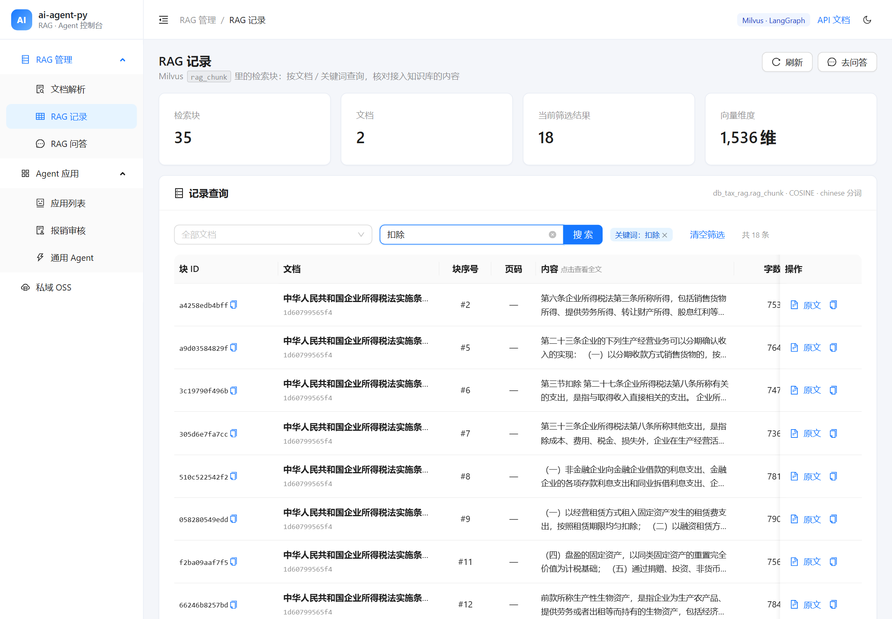
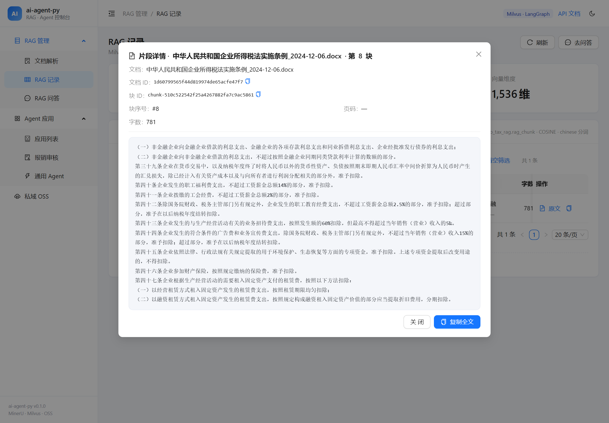
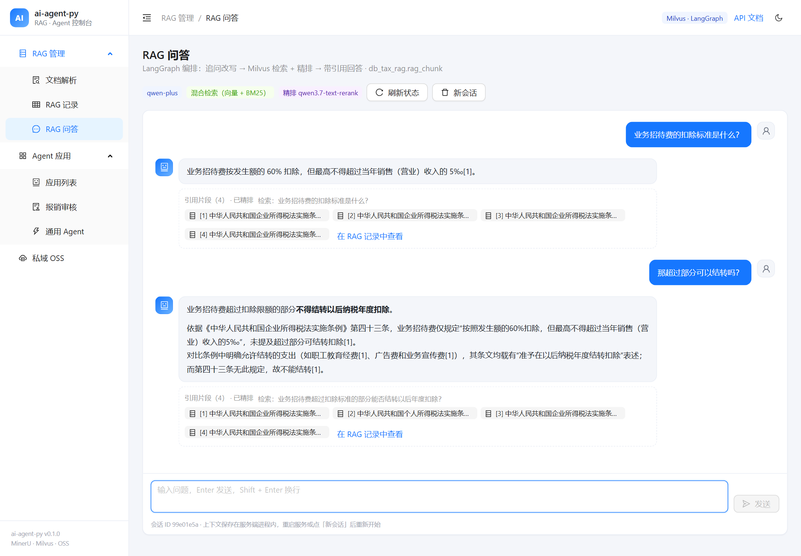
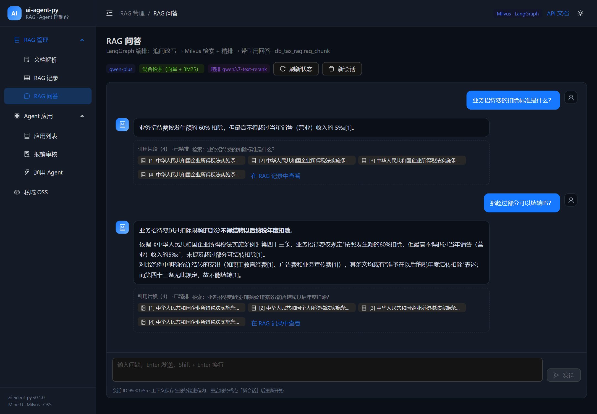
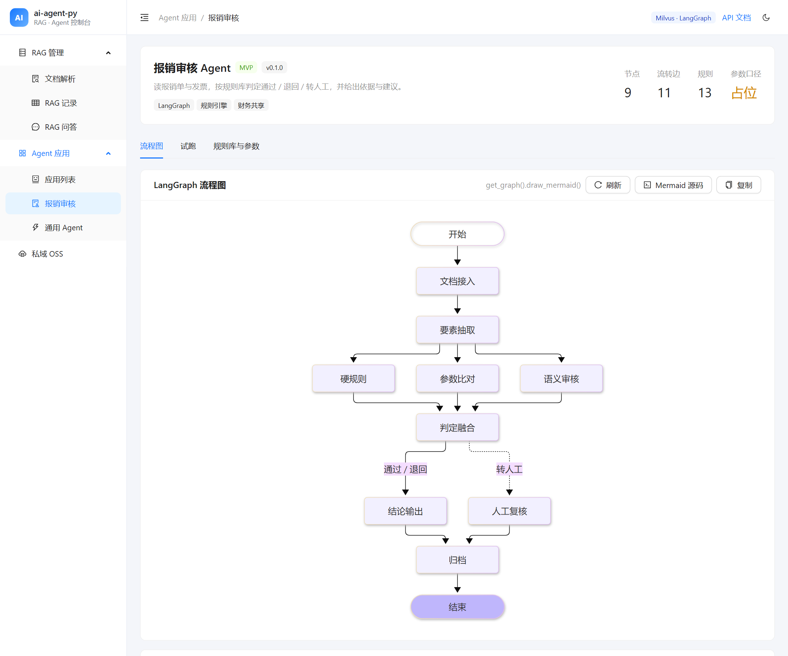
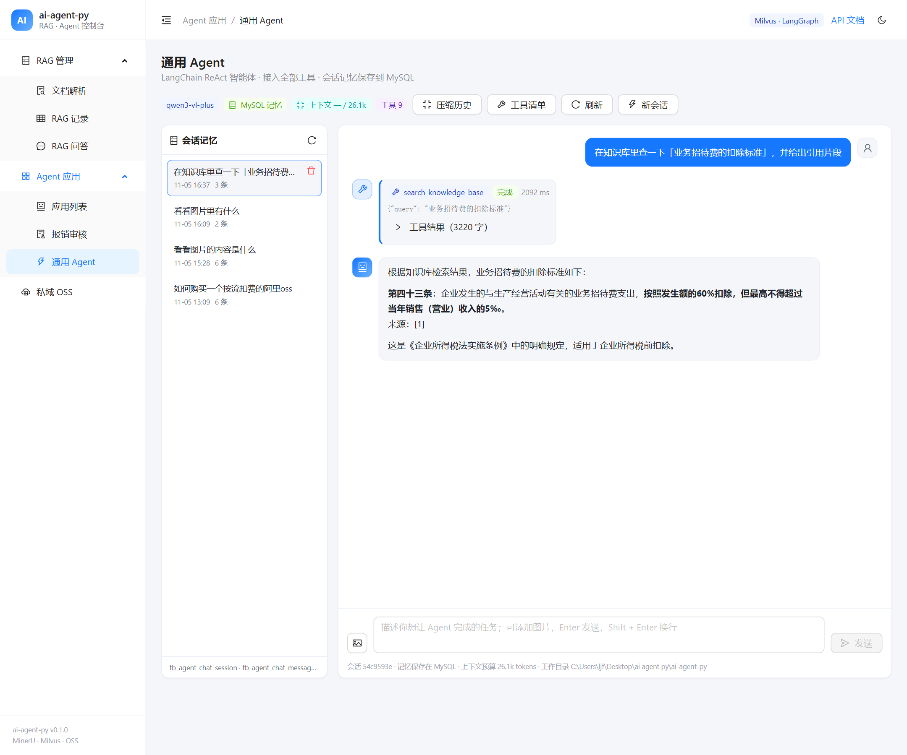
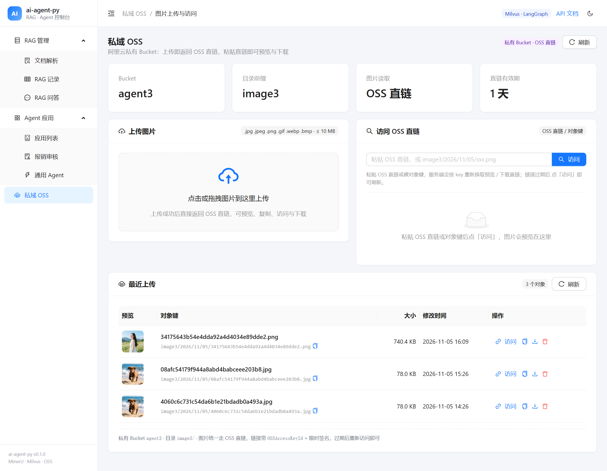
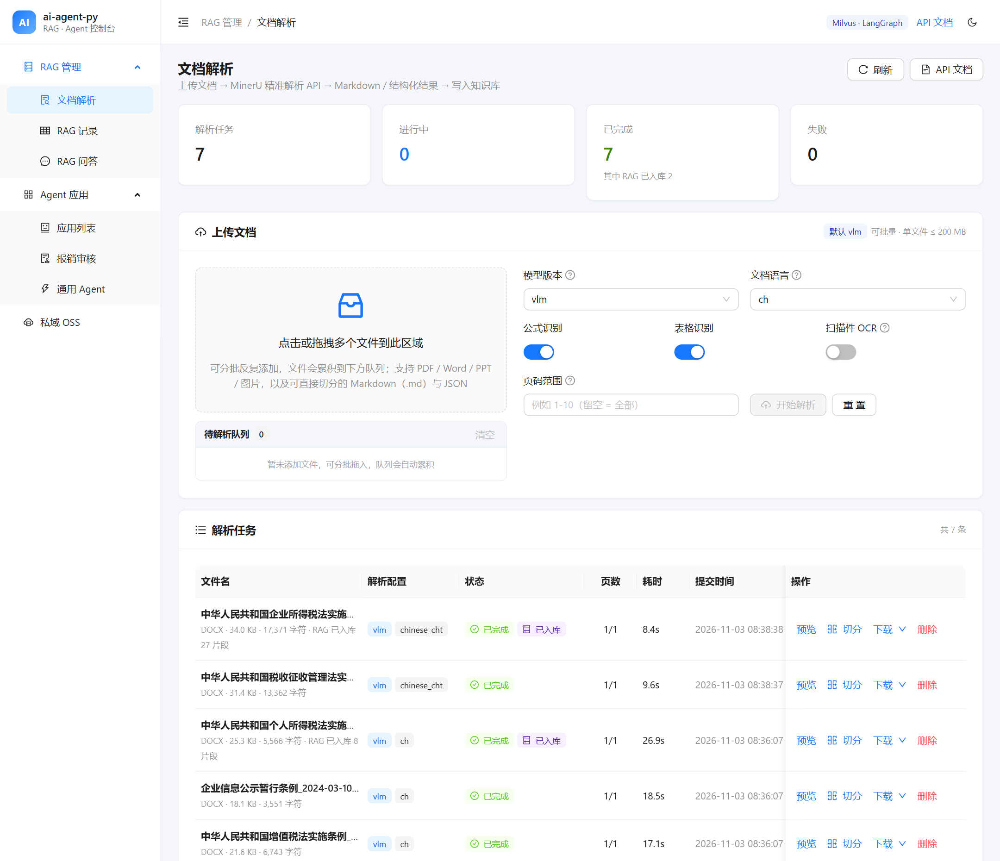
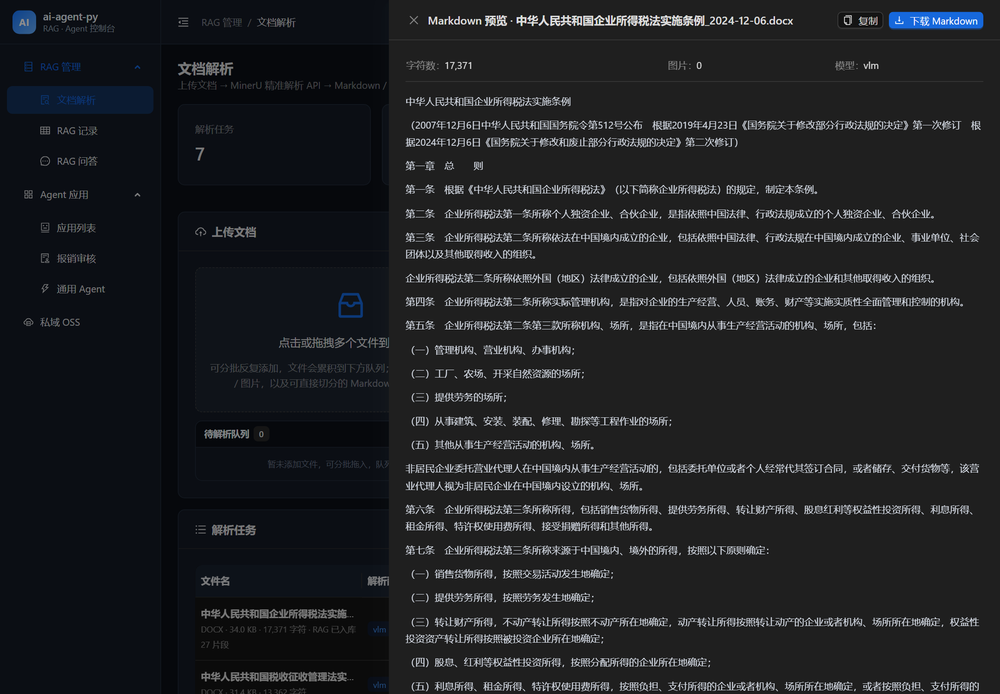

# ai-agent-py

基于 **LangChain + LangGraph** 的 RAG（检索增强生成）项目骨架，用 **uv** 管理 Python 版本与依赖。

开箱即用：`uv sync` 之后可以直接 `uv run ai-agent-py demo`，**不需要任何 API Key** 就能离线跑通
「加载 → 切块 → 向量化 → 检索 → 生成」全流程；配置好 `.env` 后即可切换成真实模型。

```text
┌──────────┐   loaders   ┌──────────┐  splitter  ┌────────┐  embeddings  ┌──────────────────┐
│ txt/md   │ ──────────▶ │ Document │ ─────────▶ │ chunks │ ───────────▶ │ Milvus rag_chunk │
│ pdf/docx │             └──────────┘            └────────┘              └────────┬─────────┘
└──────────┘                                                                       │
                                        ┌──────────────────────────────────────────┘
   问题 ──────────────────────────────▶ 混合检索 ──▶ 相关片段（带来源）
     │
     ├─ RAG 链（LCEL）：  prompt(上下文 + 问题) → LLM → 答案 + 引用
     ├─ 智能体（LangGraph）： agent ⇄ tools(search_knowledge_base) → 答案
     ├─ RAG 问答（LangGraph）： condense → retrieve(Milvus rag_chunk)
     │                          → resolve(MySQL 文件名) → answer
     │                          → SSE 流式答案 + 引用校验 + 引用片段
     └─ 通用 Agent（LangGraph）： agent ⇄ 全部工具（文件 / 命令 / 知识库 / 联网）
                                → MySQL 会话记忆 + SSE 实时工具调用
```

## 特性

- **四套调用路径，按场景选择**
  - RAG 链（LCEL）：检索一次即生成，延迟低、成本可控，适合问答接口。
  - LangGraph 智能体：`agent ⇄ tools` 状态图，模型自己决定要不要检索、检索几轮。
  - RAG 问答（LangGraph 固定链）：`condense → retrieve(Milvus) → resolve(MySQL 文件名) → answer`，
    多轮改写 + 混合检索 + 精排 + 文件名引用，前端 SSE 流式渲染。
  - 通用 Agent（LangGraph ReAct + 全部工具）：文件 / 命令 / 知识库 / 联网都能用，
    会话记忆落 MySQL，前端 SSE 实时展示工具调用。
- **可插拔**：对话模型、向量模型、检索器（`DocumentSearcher` 协议）、文件类型都通过配置或依赖注入替换，业务代码不动。
- **结构化切分 + 缓存式入库 RAG**：切分统一读解析结果 `markdown_file`（JSON 直读任务从
  `full.md` 的代码块还原原文后按结构切），切片在服务端 HashMap 里缓存并返回 `split_id`；
  前端「切分」弹窗把切片逐条展示给用户查阅，点「入库 RAG」时只回传 `split_id`
  （请求体几十字节），后端从缓存取完整切片写入 Milvus `rag_chunk`
  （百炼 `text-embedding-v4`，1536 维），不重新切分、不受预览截断影响。
  **入库成功后文档记录显示「已入库」**；**允许重复入库**——每次先删除该文档的旧切片，
  再写入新切片，换块大小或正文有改动都不会留下旧块 / 重复块。
- **Milvus 建表脚本**：通用业务 RAG 表（稠密 + BM25 + 分区过滤 + 引用元数据），
  一条命令建集合，见 [docs/milvus/create_rag_chunk.py](docs/milvus/create_rag_chunk.py)。
- **MySQL 对接**：直接连接本地 `db_py_agent`（JDBC 风格 URL 自动翻译）。
  文档解析的任务记录落在 `tb_document_parse_job`（建表脚本见 [docs/mysql/](docs/mysql/)），
  另提供 `ai-agent-py db check` 与 `/api/db/health` 的连接/库信息检查。
- **可测试**：`tests/` 全部使用脚本化假模型 + 词法哈希向量，`pytest` 不联网、不花钱。
- **三个入口**：命令行（Typer + Rich）、Python API、HTTP 服务（FastAPI）。
- **文档解析**：对接 [MinerU 精准解析 API](https://mineru.net/apiManage/docs)（推荐 `vlm` 模型），
  上传 PDF / Word / PPT / 图片 → 云端解析 → Markdown（含表格、公式、图片），可一键写入知识库。
- **管理后台**：React 19 + TypeScript + Ant Design，栏目「RAG 管理 → 文档解析 / RAG 记录 / RAG 问答」，
  支持多文件、多批次加入待解析队列，点击后按顺序逐个提交，任务进度、Markdown 预览、下载、
  切分预览、入库 RAG 一站式完成；右上角一键切换 **亮色 / 暗色主题**。
- **私域 OSS**：对接阿里云 OSS **私有 Bucket**（`agent3` / 目录 `image3`），后台新增「私域 OSS」栏目：
  上传图片即时返回 **OSS 直链**（预览 + 附件下载），粘贴直链即可预览、下载，支持删除；页面无需
  输入口令，后端从 `.env` 读取 `OSS_ACCESS_TOKEN` 并签发 HttpOnly 会话 Cookie，脚本仍可用
  `X-OSS-Access` 访问。图片统一走 OSS 直链，直链含 `OSSAccessKeyId` + 限时签名，Secret 只留在服务端。
- **RAG 记录**：直接分页浏览 Milvus `rag_chunk`，可按文档 / 正文关键词（中缀）过滤，展示总块数、
  文档分布与向量维度；文档名按 `doc_id` 从 MySQL 任务表回查，一键跳到「文档解析」看原文。
  列表先按 `(doc_id, chunk_index)` 全局排序再回查正文，翻页时块序号连续、可读；内容只展示前两行，
  **点击整格可在弹窗查看完整片段**（含文档 ID、块 ID、页码、字数）并一键复制全文。
- **RAG 问答**：聊天式问答页 + **LangGraph** 编排的 `condense → retrieve → resolve → answer` 图：
  多轮追问先改写成独立问题，再在 `rag_chunk` 上做稠密 + BM25 + RRF 混合检索，RRF 后再用
  `qwen3.7-text-rerank` 精排；检索后按 `doc_id` 回查 MySQL 文件名，让模型在提示词里看到
  「来源：xxx.docx」而不是 `doc-1a2b…`，最后带 `[1] [2]` 引用作答。答案引用会做**存在性、
  数字归一化与支持度校验**：越界编号和与资料数字冲突的引用会被移除并提示，术语重合度低
  只标黄保留；正文 `[n]` 可点击定位到下方来源片段。答案通过 **SSE 逐 token 推送**，
  引用片段可点开查看原文与相关度；页头标签实时显示 LLM 模型、检索方式与精排是否启用。
  页面底部可**按文档限定检索范围**（请求体 `doc_ids`），不选则检索全部已入库文档。
  （没有 Embedding Key 时自动退化为 BM25 关键词检索；没有精排 Key 时跳过精排；没有 LLM Key
  时页面给出明确提示。）
- **Agent 应用（报销审核）**：`reimburse` 是一张 9 节点的 LangGraph 工序图（G1 接入 → G2 抽取 →
  G3/G4/G5 三类检查并行 → G6 判定融合 → G7 结论 / G8 人工 → G9 归档），规则库 13 条（YAML 元数据 +
  判定器注册表）。后台「Agent 应用」栏目直接展示 **`get_graph().draw_mermaid()` 导出的流程图**，
  可切换主题、查看原始 Mermaid 源码；试跑页支持**下载填充好的 xlsx 样板 / 空白模板**，
  也可以**直接上传填好的单据（xlsx / json）**解析后试跑；语义疑点只会转人工，不会自动退回。
- **通用 Agent（全部工具 + MySQL 会话记忆）**：后台「Agent 应用 → 通用 Agent」是一张
  LangChain / LangGraph 的 `agent ⇄ tools` 图，**一次接入全部工具**：知识库检索
  （`search_knowledge_base`）、文件读写（`read` / `write` / `edit` / `glob` / `grep`）、
  命令执行（`shell`）、联网（`web_search` / `web_extract`）。对话通过 **SSE 流式输出**，
  工具调用（名称 / 入参 / 结果 / 耗时）实时展示；**会话记忆落在 MySQL**
  （`tb_agent_chat_session` / `tb_agent_chat_message` / `tb_agent_chat_summary`），
  刷新页面、重启服务后仍可回放并继续追问。**上下文压缩**分三层：工具输出头尾修剪、
  历史 token 预算、MySQL 滚动摘要（8 节结构化检查点），并支持溢出重试与手动压缩。
  **聊天窗支持多选图片**：选中后先本地预览、可逐张移除，点「发送」时才上传到私域 OSS；
  抓到的 OSS 直链以 Markdown 图片链接随用户消息写入 MySQL，气泡里显示缩略图。
  发给模型时按 LangChain 标准内容块 `{"type": "image", "url": ...}` 组装（`ChatOpenAI`
  会自动转换为 provider 原生的 `image_url`），**通用 Agent 使用 `GENERAL_AGENT_MODEL`**
  （留空跟随 `LLM_MODEL`），接收图片时需要支持视觉的模型（如 `qwen3-vl-plus`）；
  历史回放时同样会把图片链接还原成 image 块。
- **中文友好**：分块规则针对中文标点调优，提示词与 CLI / 前端输出均为中文。

## 目录结构

```text
ai-agent-py/
├── pyproject.toml            # 依赖、入口点、ruff/mypy/pytest 配置
├── uv.lock                   # uv 锁定文件（建议提交）
├── .python-version           # 3.13，uv 会自动使用/下载
├── .env.example              # 配置模板：复制为 .env 后填写
├── scripts/
│   ├── milvus-start.ps1      # 启动 WSL1 里的 Milvus（独立 wsl.exe 宿主 + healthz 就绪等待）
│   └── milvus-stop.ps1       # 停止 Milvus（SIGTERM，等待 19530 端口关闭）
├── data/
│   ├── raw/                  # 待索引文档（内置 sample.md）
│   ├── parsed/               # MinerU 解析结果（Markdown + 图片；任务记录在 MySQL）
│   └── rag_delete_pending/   # RAG 切片补删队列（删除文档时 Milvus 不可用的兜底）
├── src/ai_agent_py/
│   ├── config.py             # pydantic-settings：全部配置项 + 脱敏描述
│   ├── llm.py                # 对话模型 / 向量模型工厂（OpenAI 兼容协议）
│   ├── offline.py            # 离线用的占位模型、哈希向量与内存检索器（demo & 测试）
│   ├── cli.py                # 命令行：info/db/ingest/ask/chat/demo/parse/serve
│   ├── alioss/               # 阿里云 OSS（私有图片：V1 签名 / OSS 直链 / access 会话）
│   │   ├── client.py         # OSS V1 签名 + httpx：PUT / GET / LIST / DELETE / 预签名 URL
│   │   ├── service.py        # 图片校验、对象键规划、OSS 直链签名、列表与删除
│   │   └── models.py         # 上传 / 列表 / 直链 / 概览的接口模型
│   ├── db/
│   │   ├── dsn.py            # JDBC mysql:// → mysql+pymysql://（字符集 / 时区 / 超时）
│   │   ├── health.py         # 连接池 + 只读健康检查（版本 / 库 / 表数 / 连接池）
│   │   ├── document_jobs.py  # tb_document_parse_job 的行映射与 upsert / 查询 / 删除
│   │   └── agent_chat.py     # 通用 Agent 会话/消息/摘要：三张表读写、摘要条件更新
│   ├── rag/
│   │   ├── loaders.py        # txt/md/pdf/docx → Document（含编码回退、页码）
│   │   ├── splitter.py       # 按后缀：Markdown / HTML / JSON / 递归切分
│   │   ├── chunk_cache.py    # 切分结果缓存：split_id → 完整切片（TTL + LRU）
│   │   ├── filters.py        # 检索过滤条件：类型化 SearchFilter + Milvus 表达式转义
│   │   ├── citations.py      # 答案引用校验：存在性 / 数字归一化 / 支持度 / citation span
│   │   ├── milvus.py         # 切分块写入 Milvus rag_chunk（稠密 + BM25，覆盖写 / 删除）
│   │   ├── deletions.py      # RAG 切片补删队列：删除文档时 Milvus 不可用的落盘兜底
│   │   ├── milvus_search.py  # rag_chunk 混合检索（稠密 + BM25 + RRF + 精排，缺 Key 退 BM25）
│   │   ├── doc_names.py      # 检索后按 doc_id 回查 MySQL 文件名（批量 + 缓存 + 降级）
│   │   ├── rerank.py         # RRF 之后精排：qwen3.7-text-rerank（DashScope 原生接口）
│   │   ├── records.py        # rag_chunk 只读查询（RAG 记录列表 / 文档分布）
│   │   ├── models.py         # 切分预览 / RAG 入库 / RAG 记录 / 问答的接口模型
│   │   ├── ingest.py         # 建索引流水线：按源文件覆盖写 rag_chunk（进度回调）
│   │   └── chain.py          # RAG 提示词、LCEL 链、答案与引用
│   ├── mineru/               # MinerU 精准解析 API 对接
│   │   ├── client.py         # 异步 httpx：申请上传链接 / PUT / 轮询 / 下载
│   │   ├── service.py        # 任务调度：上传落盘、进度、结果持久化、入库、删除（含补删队列）
│   │   ├── archive.py        # 结果 zip 解包（防 zip slip、图片、页数）
│   │   └── models.py         # ParseJob / ParseOptions / 状态机
│   ├── graph/
│   │   ├── state.py          # AgentState（messages + add_messages 归并）
│   │   ├── nodes.py          # agent 节点、tools 节点、条件路由
│   │   ├── agent.py          # 组装并编译 StateGraph
│   │   └── rag_chat.py       # RAG 问答图：condense → retrieve → resolve → answer
│   ├── tools/
│   │   ├── __init__.py       # 工具出口：检索工具 + 通用工具构建函数
│   │   ├── workspace.py      # 工作目录约束、忽略目录、glob → 正则
│   │   ├── filesystem.py     # read / write / edit / glob / grep
│   │   ├── shell.py          # shell 执行：超时、编码、输出截断
│   │   ├── web_search.py     # 百炼联网搜索（DashScope 原生接口）
│   │   └── web_extractor.py  # 百炼网页抓取（Responses API）
│   ├── reimburse/            # 报销审核 Agent：规则库 + 9 节点图 + 图导出
│   │   ├── rules.py          # 13 条规则（YAML 元数据 + 判定器注册表）
│   │   ├── params.py         # 参数库存储：内存缓存 + 原子落盘 + 失效重载
│   │   ├── io.py             # 单据模板导出/导入（xlsx 双向 + json）
│   │   ├── graph.py          # G1–G9 工序图，describe_graph() 导出 mermaid
│   │   ├── samples.py        # 7 张合成样例单据（通过/退回/转人工）
│   │   └── data/             # rules.yaml + policy_params.yaml（占位参数）
│   ├── general/              # 通用 Agent：工具装配 / 提示词 / 上下文预算 / 摘要
│   │   ├── agent.py          # build_general_tools / build_general_agent_graph / 自定义状态节点
│   │   ├── context.py        # token 估算、历史选择、单条/单轮工具输出修剪
│   │   └── summary.py        # 8 节结构化摘要 prompt 与摘要调用
│   └── api/
│       ├── app.py            # FastAPI：/query /chat /health /info + 前端托管
│       ├── database.py       # MySQL 健康检查接口：/api/db/health
│       ├── documents.py      # 文档解析接口：上传 / 状态 / 预览 / 下载 / 切分 / 入库 / 删除
│       ├── agents.py         # Agent 应用：列表 / 图导出 / 样例 / 试跑
│       ├── general_agent.py  # 通用 Agent：概览 / MySQL 会话 / 对话（含 SSE 流式）
│       ├── oss.py            # 私域 OSS：上传 / 列举 / 换取直链 / 删除（access 鉴权）
│       └── rag.py            # RAG 记录列表 + RAG 问答（含 SSE 流式）
├── web/                      # 管理后台（文档解析 / RAG 记录 / RAG 问答 / Agent 应用 / 通用 Agent / 私域 OSS）
└── tests/                    # pytest：加载、切分、链路、图、API、CLI、MinerU、MySQL、RAG、通用 Agent
```

## 快速开始

前置：安装 [uv](https://docs.astral.sh/uv/)（Windows 可用 `winget install --id=astral-sh.uv` 或
`powershell -c "irm https://astral.sh/uv/install.ps1 | iex"`）。

```powershell
# 1. 安装依赖（自动创建 .venv，并按 .python-version 选择 Python 3.13）
uv sync

# 2. 离线自检：不需要 API Key
uv run ai-agent-py demo

# 3. 配置真实模型
Copy-Item .env.example .env      # 然后编辑 .env：填 LLM_API_KEY（或导出 DASHSCOPE_API_KEY）与向量模型 Key

# 4. 检查本地 MySQL（库已存在时只做连接检查）
uv run ai-agent-py db check

# 5. 建索引 + 提问（写入 Milvus rag_chunk）
uv run ai-agent-py ingest data/raw
uv run ai-agent-py ask "这个项目用什么管理依赖？"

# 6. 管理后台（构建一次，之后由 FastAPI 直接托管）
cd web
pnpm install
pnpm build
cd ..
uv run ai-agent-py serve          # 打开 http://127.0.0.1:8000/
```

bash / macOS 下把 `Copy-Item` 换成 `cp` 即可。前端需要 Node.js 20+ 与 pnpm。

### 常用命令

| 命令 | 说明 |
| --- | --- |
| `uv run ai-agent-py demo` | 离线跑通全流程，验证代码与数据路径 |
| `uv run ai-agent-py ingest [路径...]` | 建索引（按源文件覆盖写 Milvus），默认读取 `DATA_DIR` |
| `uv run ai-agent-py ask "问题"` | 单次问答（RAG 链），输出答案 + 引用片段 |
| `uv run ai-agent-py ask "问题" --stream` | 流式输出（逐 token 打印） |
| `uv run ai-agent-py chat` | 多轮对话（LangGraph 智能体，带工具调用与上下文） |
| `uv run ai-agent-py parse 文件.pdf -o out.md` | 调用 MinerU 精准解析 API 把文档转成 Markdown |
| `uv run ai-agent-py db check` | 连接本地 MySQL，输出服务端版本、库名、表数、耗时与连接池 |
| `uv run ai-agent-py info` | 查看当前配置（密钥脱敏）与索引 chunk 数 |
| `uv run ai-agent-py serve` | 启动 FastAPI + 管理后台，<http://127.0.0.1:8000/> |

也可以 `uv run python -m ai_agent_py ...`，行为完全一致。

### HTTP 接口

```powershell
uv run ai-agent-py serve --port 8000

Invoke-RestMethod -Uri http://127.0.0.1:8000/query -Method Post `
  -ContentType 'application/json' -Body '{"question":"这个项目用什么管理依赖？","k":4}'
```

| 方法 | 路径 | 说明 |
| --- | --- | --- |
| POST | `/query` | RAG 链问答，返回 `answer` + `sources` + `citations` + `citation_stats`（引用已做存在性/数字校验） |
| POST | `/chat` | 智能体对话，`thread_id` 相同则保留上下文 |
| GET | `/api/agents` | Agent 应用列表（节点数 / 规则数） |
| GET | `/api/agents/{id}/graph` | LangGraph 图导出：`mermaid` 源码 + 节点 / 边 |
| GET | `/api/agents/{id}/config` | 规则库与参数（参数默认标 `placeholder`） |
| PUT | `/api/agents/{id}/config/params` | 覆盖写入参数：校验 → 落盘 → 刷新缓存，立即生效 |
| POST | `/api/agents/{id}/config/reload` | 手工改了 YAML 后重新读取参数文件 |
| POST | `/api/agents/{id}/run` | 试跑一单：`{"sample_id": "C001"}` 或 `{"claim": {...}}` |
| GET | `/api/agents/{id}/template` | 空白报销单模板（xlsx） |
| GET | `/api/agents/{id}/samples/{sid}/download` | 样例样板下载（`fmt=xlsx` 或 `json`） |
| POST | `/api/agents/{id}/upload` | 上传填好的单据（xlsx/json）→ 解析成 claim |
| GET | `/api/general-agent/overview` | **通用 Agent** 概览：对话模型、工作目录、全部工具、MySQL 会话记忆状态 |
| GET | `/api/general-agent/sessions` | MySQL 会话列表（标题 / 消息数 / 最近更新时间） |
| GET | `/api/general-agent/sessions/{id}/messages` | 会话消息回放（user / assistant / 工具调用记录，含 `compressed` 标记与摘要） |
| POST | `/api/general-agent/sessions/{id}/compact` | 手动压缩更早历史（`{"keep": 8}` 可选），返回压缩条数与摘要 |
| DELETE | `/api/general-agent/sessions/{id}` | 删除会话及其全部消息 |
| POST | `/api/general-agent/chat` | 通用 Agent 对话（同步）：`answer` + 本轮新增的助手 / 工具消息；可选 `images`（OSS 直链，最多 9 张，后端转成标准 image 内容块） |
| POST | `/api/general-agent/chat/stream` | 同上，SSE 流式：`session` →（`tool_call` → `tool_result`）… → `token`… → `done`；`images` 处理方式相同 |
| GET | `/health` | 版本、模型、向量库、chunk 数与 MySQL 连接状态 |
| GET | `/info` | 配置快照（密钥脱敏） |
| GET | `/api/db/health` | MySQL 连接检查：服务端版本、库名、表数、时区、耗时、连接池 |
| GET | `/api/documents/config` | 解析能力、可上传后缀、RAG 入库目标（集合 / 维度 / 是否配置 Key） |
| POST | `/api/documents/parse` | 上传文档（multipart）→ 立即返回任务（202）；`.md` / `.json` 直接完成 |
| GET | `/api/documents` | 任务列表（`state` / `keyword` / `limit` 过滤） |
| GET | `/api/documents/{id}` | 任务状态与进度 |
| GET | `/api/documents/{id}/markdown` | Markdown 预览 |
| GET | `/api/documents/{id}/download?kind=markdown\|zip\|source` | 下载结果 |
| GET | `/api/documents/{id}/chunks` | **切分预览**：读 `markdown_file` 切分，返回 `split_id` + 片段与统计 |
| POST | `/api/documents/{id}/rag` | **按 `split_id` 从缓存取切片写入 Milvus** `db_tax_rag.rag_chunk`（可重复入库：先删旧切片；成功后任务记录 `rag_ingested=true`） |
| DELETE | `/api/documents/{id}` | 删除任务、结果、源文件与 `rag_chunk` 切片（Milvus 不可用时转后台补删，仍返回 204） |
| GET | `/parsed/{id}/images/...` | 解析结果里的图片（Markdown 预览用） |
| GET | `/api/oss/overview` | **私域 OSS** 配置：Bucket / 目录 / 访问要求 / 大小上限（不含密钥）；同时签发页面会话 Cookie |
| POST | `/api/oss/images` | **上传图片**（multipart；页面会话或 `X-OSS-Access`）→ `key` + OSS 直链 `url` / `download_url` / `expires_in` |
| GET | `/api/oss/presign?key=...` | 按对象键换取新的 OSS 直链（预览 + 附件下载） |
| GET | `/api/oss/objects` | 列举 `OSS_PREFIX/` 下的图片（最新在前；每项带 OSS 直链） |
| DELETE | `/api/oss/images/{key}` | 删除图片（会话或 `X-OSS-Access`） |
| GET | `/api/rag/overview` | **RAG 记录 / 问答**概览：Milvus 连接、总块数、文档分布、模型配置状态（含精排 `rerank_model` / `rerank_configured`） |
| GET | `/api/rag/chunks` | **`rag_chunk` 记录列表**：`doc_id` / `keyword` / `page` / `page_size` |
| POST | `/api/rag/chat` | **RAG 问答**（LangGraph，`thread_id` 保留多轮上下文，`doc_ids` 限定检索文档）→ `answer` + `sources` + `citations` + `citation_stats` |
| POST | `/api/rag/chat/stream` | 同上，SSE 流式：`stage` → `sources` → `token`… → `done`（`done` 带 `citations` / `citation_stats`） |

## 切分与入库 RAG（百炼 text-embedding-v4 + Milvus）

「文档解析」列表每行都有 **切分** 按钮，流程是 **切分 → 缓存 → 用户查阅 → 入库**：

1. 后端**只读**任务的 `markdown_file`（MinerU 产出的 `full.md`；`.md` 任务就是源文件）
   切分，保证弹窗里的切片与 Markdown 预览同源；
2. 切分结果写进服务端进程内 HashMap（`rag/chunk_cache.py`），接口返回 `split_id`；
   弹窗逐条展示切片（标题层级、页码、字符数），改块大小后点「重新切分」会生成新 id；
3. 点 **入库 RAG** 时，前端只 `POST {"split_id": "...", "total": N}`，后端按 id 从
   缓存取出**完整**切片（预览截断不影响入库）写入 `db_tax_rag.rag_chunk`，返回
   `mode="cached"`。不传 `split_id` 的调用方仍可回传 `chunks`（无状态 / 多实例），
   或两者都不传让服务端重新切分（CLI / 脚本）。

| 文档类型 | 切分来源 | 切分器 | 说明 |
| --- | --- | --- | --- |
| `.md` / `.markdown` | 源文件（即 `markdown_file`） | `MarkdownHeaderTextSplitter` | 按 `#`~`####` 标题层级切，标题写入 metadata |
| `.json` | `full.md` 里的 json 代码块 | `RecursiveJsonSplitter` | 取回块内原文按嵌套结构切；单个超长字符串值不再硬切，保证片段是合法 JSON |
| HTML / PDF / DOCX / PPT / 图片 | MinerU 产出的 `full.md` | `MarkdownHeaderTextSplitter` | 不再回读原始 HTML；统一按 Markdown 标题结构切 |

- 结构化切分器只决定「在哪里切」，不保证块大小；除 JSON 外都会再走一遍递归切分兜底，
  确保单块 ≤ `chunk_size`。
- `.md` / `.json` 不调用 MinerU，上传后立即完成。
- **缓存边界**：默认 TTL 30 分钟、最多 16 条、总字符 8M（LRU 淘汰）；只存在本进程内存，
  服务重启 / 换实例后 `split_id` 失效，接口返回 409 并提示重新切分（前端会自动重切）。
  多实例部署要么做粘性会话，要么用无状态的 `chunks` 入参。
- 弹窗最多渲染 5000 个切片；超出时只提示「仅展示前 N 个」，入库仍会写入缓存的全部切片。
- 前端回传时带上 `total`（切分总数）：与实际入库数量不一致直接 422，避免切分结果错位。
- 删除任务时会清掉该任务的全部切分缓存，并**删除 Milvus `rag_chunk` 里该文档的全部切片**
  （删除对称，见下文「删除文档」）。
- **重复入库**：每次写 Milvus 前先按 `doc_id` 删除该文档的**全部**旧切片，再 `upsert`
  本次切片；换 `chunk_size` / 修改正文后重新入库不会留下孤儿块或重复块。embedding
  计算成功后才执行删除，向量模型失败不会先丢掉旧数据。
- **已入库状态**：RAG 入库成功后任务记录写入 `rag_ingest`（块数、字符数、目标集合、
  入库时间），列表「状态」列在解析状态下方显示「已入库」；重新入库只刷新这份摘要，
  可以反复操作。
- 向量模型默认走阿里云百炼 OpenAI 兼容接口：`DASHSCOPE_API_KEY` +
  `text-embedding-v4` + `EMBEDDING_DIMENSIONS=1536`（必须等于 `MILVUS_DIM`）。
- `sparse`（BM25）由 Milvus 服务端根据 `content` 生成，应用写入时不赋值。

```powershell
# 1. 确认 Milvus 与集合已就绪（dim 与 EMBEDDING_DIMENSIONS 一致）
uv run python docs/milvus/create_database.py
uv run python docs/milvus/create_rag_chunk.py --dim 1536

# 2. 设置百炼 Key（推荐环境变量；也可写进 .env）
$env:DASHSCOPE_API_KEY = "sk-..."

# 3. 启动管理后台：上传 → 切分 → 查阅切片 → 入库 RAG
uv run ai-agent-py serve --port 8000
```

#### 删除文档（删除对称）

- 删除解析任务时，若该文档入过库（`rag_ingest` 非空），会同时调用
  `MilvusRagWriter.delete_document(doc_id)` 清掉 `rag_chunk` 里它的**全部**切片；
  向量必须和任务记录一起消失，否则问答还会引用「已删除」的文档。
- **Milvus 不可用不阻塞删除**：删除失败时把 `doc_id` 落盘到 `RAG_DELETE_PENDING_DIR`
  （默认 `data/rag_delete_pending/`，一个 doc_id 一个 JSON 标记），接口仍返回 204；
  后台每 60 秒重试一次，成功一条删一条标记，服务重启后启动时自动续跑。
- 没入过库的文档不连 Milvus：只有 `rag_ingest` 非空的任务才需要补删。
- 标记目录与 `data/parsed` 一样是本地运行态资产：多实例共用同一份目录时重复删除是
  幂等的；将来实例之间不共享磁盘时再换成 Redis / MySQL 队列。

## RAG 记录与 RAG 问答（Milvus `rag_chunk` + LangGraph）

入库完成后，管理后台多了两个栏目：**RAG 记录**（核对写进 `rag_chunk` 的内容）和
**RAG 问答**（聊天式检索问答）。两者都只读 Milvus 的 `rag_chunk`，与「文档解析 → 切分 →
入库 RAG」共用同一份数据。









### RAG 记录（`GET /api/rag/chunks`）

- 只返回 `chunk_id` / `doc_id` / `chunk_index` / `page` / `content`，**不搬** `embedding` /
  `sparse` 两个向量字段；
- 总数用 Milvus `count(*)` 聚合，分页与过滤严格一致；
- 过滤条件：`doc_id`（精确）+ `keyword`（`content like "%kw%"` 中缀匹配，Milvus 2.5+ 支持）；
- Milvus `query` **不支持 ORDER BY**，所以常规浏览会先扫一遍轻量元数据（主键 + 文档 +
  序号 + 页码），在应用侧按 `(doc_id, chunk_index)` 排序，再按本页主键回查正文——翻页时
  块序号连续，读起来就是原文顺序；
- 关键词查询 / 集合超过 16384 块时退回服务端 `offset/limit` 分页（只保证页内有序，
  响应里的 `truncated=true` 会提示）；
- 文档名不在 Milvus 里：接口用 `doc_id` 回查 MySQL `tb_document_parse_job`，查不到就显示
  `doc_id`，MySQL 不可用不影响记录浏览；
- 列表的「内容」列只展示前两行，**点击整格弹出片段详情**：展示完整正文（可滚动）、文档 ID /
  块 ID / 块序号 / 页码 / 字数，并支持「复制全文」；表头带「点击查看全文」提示，键盘
  `Enter` / 空格也可打开详情。

```powershell
Invoke-RestMethod "http://127.0.0.1:8000/api/rag/overview"
Invoke-RestMethod "http://127.0.0.1:8000/api/rag/chunks?keyword=业务招待费&page=1&page_size=10"
```

### RAG 问答（`graph/rag_chat.py`，LangGraph）

```text
START ──▶ condense ──▶ retrieve ──▶ resolve ──▶ answer ──▶ END
            改写追问      Milvus 检索    回查文件名    带引用作答
```

- **condense**：首轮直接使用用户问题，**不额外调模型**；存在历史对话时，才让 LLM 把
  「那它的扣除标准呢？」改写成可独立检索的问题（提示词 `CONDENSE_PROMPT`）；
- **retrieve**：`MilvusChunkSearcher` 在 `rag_chunk` 上做 **稠密 + BM25 + RRF（+ 精排）** 混合检索，
  两路各取 `MILVUS_CANDIDATES` 条，用 `RRFRanker(MILVUS_RRF_K)` 融合；配了精排时保留
  `RERANK_CANDIDATES` 条候选交给 `qwen3.7-text-rerank` 重新打分，最后取 `RETRIEVER_K` 条。
  精排失败（超时 / 401 / 配额）只记 warning 并退回 RRF 顺序，不影响问答可用性；没配精排 Key
  时这一步直接跳过（等价于只用 RRF）；
- **文档级过滤**：请求体带 `doc_ids`（最多 50 篇，单个 id ≤ 64 字符）时，只在这些文档的切片里
  检索；不传 / 传空数组表示全库。过滤条件走 `rag/filters.py` 的 `SearchFilter`——只接受类型化
  字段，表达式由 `build_filter_expr()` 生成并转义引号，不会把用户输入当表达式执行；`doc_id`
  上的 INVERTED 索引现成，三路检索（hybrid / dense / BM25）都会带上同一个过滤表达式
  （混合检索挂在每个 `AnnSearchRequest` 的 `expr` 上，单路检索用原生 `filter=`）。
  **多轮对话每轮都要带**：未带 `doc_ids` 的请求按「全库」处理，不会沿用上一轮的范围
  （前端「检索范围」选择框在每次发送时都会带上当前选择）；
- **resolve**：`rag_chunk` 只有 `doc_id`，文件名在 MySQL `tb_document_parse_job`。这里按本次
  召回的 id 批量回查文件名（`WHERE id IN (...)`，同一篇文档的多个片段只查一次，结果进程内
  缓存），写回片段 `metadata["source"]`，所以模型看到的来源是「xxx.docx」而不是
  「doc-1a2b…」。MySQL 未配置 / 宕机 / 表不存在时只记 warning，来源退回 `doc_id`，问答照常；
- **answer**：把片段按 `[1] [2]` 编号拼进提示词，并声明「共 N 条，编号 1~N」；**没有召回时
  不调用 LLM**，直接返回兜底文案（省钱、避免幻觉）；
- **引用校验**：`answer` 节点的回答会经过 `rag/citations.py::verify_citations` 后处理——解析
  `[n]` → 存在性校验（`1..N`）→ 句级归因（每条引用只对它前面、上一条引用之后的那段话负责）
  → 数字归一化（`60%` / `百分之六十` / `0.6` 视为同一值，`5‰` / `千分之五` / `0.5%` 同理）
  → 支持度判定。**编号越界、引用片段为空、数字与片段冲突**的引用会从答案里删除并计入
  `citation_stats`；术语重合度低或法条号对不上只标记 `weak`（保留引用、来源 chip 标黄），
  因为概括性正确引用的字符重合度可能很低（实测 0.07），硬删会误伤。旧实现把越界编号改写成
  「（第 N 条）」的逻辑已移除，避免把幻觉引用洗成合法引用（D-18）；
- **历史引用隔离**：上一轮答案里的 `[n]` 属于上一轮编号，`condense` / `answer` 的提示词在
  渲染历史时会先剥掉（`strip_citations`），不会和本轮重新从 1 开始的编号冲突（D-01）；
- **前端引用定位**：`citations` 带答案内 `start/end`，正文里的 `[n]` 渲染成可点击的 `<sup>`，
  点击滚动并高亮对应的来源卡片；被移除的引用在回答下方给出提示，弱支持 chip 为橙色；
- 多轮上下文由 LangGraph `InMemorySaver` 按 `thread_id` 保存在**服务端进程内**：刷新页面后
  点「新会话」换一个 `thread_id` 即可重新开始；服务重启后旧会话失效；
- 前端用 `POST /api/rag/chat/stream`（SSE）逐 token 渲染，事件顺序为
  `stage`（检索中）→ `sources`（引用片段，`resolve` 补完文件名后发送）→ 若干 `token`
  → `done`（完整答案，以它为准）；出错时发 `error` 事件；
- 降级：没有 `EMBEDDING_API_KEY` 时只走 BM25 关键词检索（集合本来就带 analyzer / BM25，
  `content` 就是索引字段）；连 `LLM_API_KEY` / `DASHSCOPE_API_KEY` 都没有时页面会提示
  「问答不可用」，接口返回 503。
- 页头标签来自 `GET /api/rag/overview`：LLM 模型、`混合检索（向量 + BM25）`/`BM25 检索`、
  `精排 qwen3.7-text-rerank`/`未启用精排`；没开精排时页面上方还有一条提示，说明会送多少条
  候选、最终取几条。引用弹窗里的「相关度」在精排后是 0~1 的精排分。

```powershell
# 非流式（脚本 / 联调）
Invoke-RestMethod -Uri http://127.0.0.1:8000/api/rag/chat -Method Post `
  -ContentType 'application/json' `
  -Body '{"message":"企业所得税的扣除项目有哪些？","thread_id":"demo-1"}'

# 只在一篇文档内检索：doc_ids 取自 /api/rag/overview 的 docs[].doc_id（每轮都要带）
Invoke-RestMethod -Uri http://127.0.0.1:8000/api/rag/chat -Method Post `
  -ContentType 'application/json' `
  -Body '{"message":"住宿费标准是多少？","thread_id":"demo-2","doc_ids":["doc-1a2b3c4d"]}'

# 流式（SSE）：浏览器里由前端 fetch 读取，命令行可用 curl -N
curl.exe -N -X POST http://127.0.0.1:8000/api/rag/chat/stream `
  -H "Content-Type: application/json" `
  -d '{"message":"业务招待费的扣除标准是什么？","thread_id":"demo-1"}'
```

## Agent 应用（报销审核 / 通用 Agent）

后台「Agent 应用」栏目汇总每个 Agent 的节点 / 规则 / 版本，点进去可直接看 LangGraph 工序图，
也提供样例试跑与通用 Agent 对话：





- **报销审核**：9 节点工序图 + 13 条规则，可下载 / 上传 xlsx 单据试跑，结果给出「通过 / 退回 / 转人工」与依据；
- **通用 Agent**：ReAct 图一次接入知识库、文件、命令、联网工具，工具调用与回答通过 SSE 实时展示，会话记忆保存在 MySQL。

## 私域 OSS（阿里云 OSS 私有 Bucket）

后台「私域 OSS」栏目对接 `agent3`（华南 1 深圳）的私有 Bucket，目录 `image3/`：

```text
浏览器 ──会话 Cookie（打开页面自动签发）──▶ FastAPI /api/oss/*（上传 / 列举 / 删除 / 换直链）
                                      │ OSS V1 签名（AccessKey 只在服务端）
                                      ▼
                              私有 Bucket agent3 / image3/<年>/<月>/<日>/<uuid>.png
                                      │
     ◀┘
                                      ↑
                              图片读取统一走 OSS 直链（不再经过本服务）
```

### 访问模型

页面打开时 `GET /api/oss/overview` 会用 `.env` 里的 `OSS_ACCESS_TOKEN` 派生一个
**HttpOnly + SameSite=Strict** 的 `oss_session` Cookie（`Path=/api/oss`）。前端不需要、
也拿不到口令本身；上传 / 列举 / 删除 / 换取直链自动带上会话。脚本仍可使用请求头：

| 操作 | 鉴权 |
| --- | --- |
| 上传 `POST /api/oss/images` | 页面会话 Cookie；脚本用 `X-OSS-Access: <OSS_ACCESS_TOKEN>`（或 `?access=`） |
| 列举 `GET /api/oss/objects` | 同上 |
| 换取直链 `GET /api/oss/presign?key=...` | 同上 |
| 删除 `DELETE /api/oss/images/{key}` | 同上 |
| 读取图片 | **OSS 直链**（预签名 GET，不需要本服务） |

- 上传与列表接口直接返回两个 OSS 直链：
  - `url`：预览直链，可直接放 ``、浏览器打开或复制；
  - `download_url`：签名里带 `response-content-disposition=attachment`，点击即下载。
- 直链里只有 `OSSAccessKeyId` + `Expires` + `Signature`，**没有 AccessKey Secret**；但链接本身是
  限时访问凭证，任何拿到链接的人都能在有效期内读取这一张图（默认 24 小时，`OSS_URL_EXPIRES`）。
  改 `OSS_ACCESS_TOKEN` **不会**吊销已发出的 OSS 直链，只能等过期或轮换 RAM AccessKey。
- 会话值 = `HMAC-SHA256(OSS_ACCESS_TOKEN, "ai-agent-py:oss-session:v1")`，口令本身不会出现在
  Cookie、JS 或 URL 里；改掉 `OSS_ACCESS_TOKEN` 后旧会话立即失效。
- `OSS_ACCESS_KEY_ID/SECRET` 只参与服务端 OSS V1 签名（`PUT/GET/LIST/DELETE` 与预签名），
  前端拿不到 Secret；Bucket 保持私有，不设置公共读。
- 所有管理接口只允许 `OSS_PREFIX/` 下的对象：`other/x.png`、`image3/../x` 一律 400；
  直链也只会为这些 key 签发。
- 上传会校验后缀、大小与文件头（PNG / JPEG / GIF / WEBP / BMP），避免把任意文件改名后塞进桶里；
  SVG 默认不允许（避免内联脚本）。
- **注意**：去掉页面口令输入后，能打开后台页面的人都能使用私域 OSS（含获取直链）；如果后台要
  暴露到公网，请在反向代理层加登录 / IP 白名单，或恢复显式 access 校验。

### 命令行示例

```powershell
$env:OSS_ACCESS = "oss_xxx"   # 与 .env 的 OSS_ACCESS_TOKEN 一致

# 上传：返回 key + 两个 OSS 直链（预览 / 下载）
$img = curl.exe -s -X POST http://127.0.0.1:8000/api/oss/images `
  -H "X-OSS-Access: $env:OSS_ACCESS" -F "file=@cat.png" | ConvertFrom-Json
$img | Select-Object key, size, url, download_url, expires_in

# 直接用 OSS 直链读取（不需要 access；浏览器 /  都能用）
Invoke-WebRequest $img.url -OutFile cat-read.png

# 直链过期后按 key 重新换取
Invoke-RestMethod "http://127.0.0.1:8000/api/oss/presign?key=$($img.key)" `
  -Headers @{ "X-OSS-Access" = $env:OSS_ACCESS }

# 列举 / 删除
Invoke-RestMethod "http://127.0.0.1:8000/api/oss/objects?limit=20" `
  -Headers @{ "X-OSS-Access" = $env:OSS_ACCESS }
Invoke-WebRequest "http://127.0.0.1:8000/api/oss/images/$($img.key)" -Method Delete `
  -Headers @{ "X-OSS-Access" = $env:OSS_ACCESS }
```

上传返回示例：

```json
{
  "key": "image3/2026/11/05/5caa913b588e408782212af392a1abfb.png",
  "name": "cat.png",
  "size": 70,
  "content_type": "image/png",
  "url": "https://agent3.oss-cn-shenzhen.aliyuncs.com/image3/...?OSSAccessKeyId=...&Expires=...&Signature=...",
  "download_url": "https://agent3.oss-cn-shenzhen.aliyuncs.com/image3/...?OSSAccessKeyId=...&Expires=...&Signature=...&response-content-disposition=attachment%3B%20filename%3D%22...%22",
  "expires_in": 86400
}
```

### 前端页面



「私域 OSS」页分三块：

1. **上传图片**：拖拽 / 选择图片 → 立即上传，展示预览、对象键、OSS 直链（一键复制）、
   `预览`、`下载` 和 `删除`；
2. **访问 OSS 直链**：粘贴 OSS 直链（或裸对象键）→ 点「访问」，服务端按 key 重新签发
   预览 / 下载直链，图片预览并支持下载；
3. **最近上传**：列出私有目录里的图片，可预览 / 复制直链 / 下载 / 删除。

页面不再要求输入访问口令：`GET /api/oss/overview` 已经从 `.env` 读取 `OSS_ACCESS_TOKEN` 并签发
会话 Cookie；口令不会出现在前端代码、localStorage 或 URL 里。

> AccessKey Secret 只存在 `.env`；但 OSS 直链里会出现 `OSSAccessKeyId`。`OSS_ACCESS_TOKEN`
> 泄露或需要让旧会话 / 旧 access 失效时，改掉它并重启服务即可（已发出的 OSS 直链仍会在
> `OSS_URL_EXPIRES` 内有效，只能等过期或轮换 RAM AccessKey）。

## Milvus 通用业务 RAG 表（唯一向量库）

Milvus `rag_chunk` 是**唯一**的向量库：`/query`、智能体的 `search_knowledge_base` 工具、
「RAG 问答」、`ai-agent-py ingest` 与「入库 RAG」全部读写这一张表，不再有第二套索引。
它提供稠密语义 + BM25 关键词 + RRF 融合 + qwen3.7 精排 + 页码引用。脚本在 `docs/milvus/`：

- [`create_database.py`](docs/milvus/create_database.py)：建库 `db_tax_rag`（幂等，可设副本/资源组/配额）；
- [`create_rag_chunk.py`](docs/milvus/create_rag_chunk.py)：建表 `rag_chunk`，**7 字段 + 3 索引 + BM25 函数**。

```powershell
uv sync                                                       # pymilvus 已是主依赖
uv run python docs/milvus/create_database.py                  # 建库 db_tax_rag
uv run python docs/milvus/create_rag_chunk.py --dim 1536      # 建表（默认进 db_tax_rag）
uv run python docs/milvus/create_rag_chunk.py --print-spec    # 不连库，打印字段/索引 JSON
uv run python docs/milvus/create_database.py --drop           # 删库（要求库内为空）
```

### 本机 Milvus（WSL1）启停

本机 Milvus 2.6 以 **原生 DEB 解包**方式装在 WSL1 `Ubuntu-20.04` 的 `~/milvus`（不用 Docker、
不用 systemd），`scripts/` 里带了一份启停脚本：

```powershell
# 启动：独立 wsl.exe 宿主常驻，等到 healthz 返回 200 才退出；已在运行则直接返回
pwsh -File scripts/milvus-start.ps1

# 停止：发 SIGTERM，等待 19530 端口关闭
pwsh -File scripts/milvus-stop.ps1

# 看日志
wsl -d Ubuntu-20.04 -- tail -f /home/ljf/milvus/milvus.log
```

- 就绪检查：<http://127.0.0.1:9091/healthz>（返回 200 即可用）；WebUI：<http://127.0.0.1:9091/webui/>
- 默认 WSL 发行版 `Ubuntu-20.04`、安装目录 `/home/ljf/milvus`，可用
  `-Distro Ubuntu-20.04` / `-WslHome /home/<用户>/milvus` / `-TimeoutSeconds 300` 覆盖；
- 启动脚本用 `Start-Process wsl.exe` 拉起独立宿主，关掉当前终端后 Milvus 仍继续运行；
- 脚本只覆盖**启停**；Milvus 本体需要先按原安装流程装到 WSL 里（本机已装好）。

建表常用参数：`--uri` / `--token`（或环境变量 `MILVUS_URI` / `MILVUS_TOKEN`）、`--database`
（默认 `db_tax_rag`，写 `default` 回默认库）、`--collection`、`--dim`（必须等于 embedding
模型输出维度）、`--metric`、`--analyzer`（`chinese` / `english` / `standard`，建表后不可改）、
`--recreate`。

表设计要点：

- 一行 = 一个检索块，只有 7 个字段：`chunk_id` / `doc_id` / `chunk_index` / `page` /
  `content` / `embedding` / `sparse`；
- **文档级属性不进 Milvus**：文件名、后缀、页数、时间在 MySQL `tb_document_parse_job`，
  `doc_id` 就是该表的 `id`，检索后由 `rag/doc_names.py` 按它回查文件名拼引用
  （避免改标题要更新 N 行）；
- 一个集合两路向量：`embedding`（稠密）+ `sparse`（BM25，服务端自动生成，**不要手写**）；
- 主键是稳定 `chunk_id`（`sha1(doc_id|chunk_index|content)`），重灌幂等，不会产生重复块；
- `content` 开 analyzer 后同时作为 BM25 输入；`page` 用于引用回溯（PDF 有，docx 转 md 为 NULL）；
- 将来要加过滤维度（租户/知识库）或分区键，再按需 `add_field` 或重建集合；
- 换 embedding 模型 = 换维度 = **建新集合 + 回填 + 别名切换**，不要原地改；
- 集合在 Milvus 重启后是 `released` 状态，检索前要 `load_collection`（脚本创建时已 load）。

应用侧写入在 `src/ai_agent_py/rag/milvus.py`（`MilvusRagWriter`）：按 `doc_id` 覆盖写、
只写 `content` + `embedding`（`sparse` 由服务端生成）、删除旧块后 `upsert` 并 flush。
读取在 `rag/records.py`（记录列表），混合检索（`embedding` + `sparse` + RRF）在
`rag/milvus_search.py`：`/query`、智能体检索工具、「RAG 问答」（`/api/rag/chat`）与
`ai-agent-py ask/chat` 都走这一条链路，同一份资料只有一套索引。

## MySQL 对接（只读健康检查）

本次对接的库是 `db_py_agent`。只做**连接与健康检查**：
打开连接池、执行 `SELECT` 读取服务端信息，**不建表、不改数据、不读取业务表内容**。
如果这个库还没有建表，`db check` 会显示表数量 0，但连接本身仍算正常。

```ini
MYSQL_URL=jdbc:mysql://localhost:3306/db_py_agent?useUnicode=true&characterEncoding=utf8&connectionTimeZone=Asia/Shanghai&allowPublicKeyRetrieval=true&useSSL=false
MYSQL_USERNAME=admin
MYSQL_PASSWORD=change-me
MYSQL_POOL_SIZE=5
MYSQL_MAX_OVERFLOW=10
MYSQL_POOL_RECYCLE=1800
MYSQL_CONNECT_TIMEOUT=5
```

`MYSQL_URL` 同时接受 Java 的 `jdbc:mysql://` 与 SQLAlchemy 的 `mysql+pymysql://` 写法，
连接参数在 `src/ai_agent_py/db/dsn.py` 里翻译：

| 原参数 | 处理 |
| --- | --- |
| `characterEncoding=utf8` | → `charset=utf8mb4`（中文与 emoji 都能存） |
| `connectionTimeZone=Asia/Shanghai` | → 连接时 `SET time_zone = '+08:00'` |
| `connectTimeout`（JDBC，毫秒） | 由 `MYSQL_CONNECT_TIMEOUT`（秒）统一控制 |
| `useUnicode` / `allowPublicKeyRetrieval` / `useSSL=false` | JDBC 专用，PyMySQL 默认行为已满足 |

```powershell
uv run ai-agent-py db check
# 或
Invoke-RestMethod http://127.0.0.1:8000/api/db/health
```

输出包括：状态、服务端版本、当前账号、库名、表数量、会话时区、连接耗时、连接池
（`size` / `checkedin` / `checkedout`）。失败时 `status=down` 并给出中文原因（密码错误、
库不存在、服务未启动、超时等），CLI 以退出码 1 结束。密码只存在 `.env` 与引擎内部，
`/info`、`/api/db/health` 和日志里的连接串都显示为 `***`。

> 连接池使用 `pool_pre_ping=True`：MySQL 重启或空闲连接被回收后，下一次检查会自动重连，
> 不会把失效连接留给请求。健康检查失败不会影响 RAG / 文档解析等现有功能。

### 建库脚本

数据库编码读取结果（`information_schema.SCHEMATA`）：

| 库 | 默认字符集 | 默认排序规则 |
| --- | --- | --- |
| `db_py_agent`（读取时） | `utf8mb4` | `utf8mb4_general_ci` |
| `db_ai_agent`（源库，23 张表） | `utf8mb4` | `utf8mb4_0900_ai_ci` |
| 服务端默认 | `utf8mb4` | `utf8mb4_0900_ai_ci` |

[`docs/db/create_database.sql`](docs/db/create_database.sql) 默认复刻 `db_py_agent`
读取到的值（`utf8mb4` + `utf8mb4_general_ci`），可在 MySQL 客户端中直接执行；脚本只创建 / 对齐
数据库本身，不建表、不写数据。文末另附一段取消注释即可使用的 `ALTER`，用于把默认排序规则
改成与源库一致的 `utf8mb4_0900_ai_ci`。

## 文档解析（MinerU 精准解析 API）

对接官方 [精准解析 API](https://mineru.net/apiManage/docs)：支持 `pipeline` / `vlm`（默认，精度最高）/
`MinerU-HTML`，单文件 ≤ 200 MB、≤ 600 页，支持 PDF、图片、Doc/Docx、Ppt/PPTx。





主题切换按钮在页面右上角（月亮/太阳图标）：选择写入 `localStorage`，刷新后保持；
从未切换过时跟随系统 `prefers-color-scheme`。`index.html` 里的内联脚本会在首屏渲染前
写好 `<html data-theme>`，避免暗色模式下闪白。

### 为什么走「批量上传」接口

精准解析 API 的单文件接口 `POST /extract/task` 只接受 **URL**，本地文件必须走批量上传链路：

```text
① POST /file-urls/batch            申请上传链接 → batch_id + file_urls
② PUT  <file_url>                  上传文件字节（不设 Content-Type）
                                   ← MinerU 自动提交解析任务
③ GET  /extract-results/batch/{id} 轮询 state: pending → running → done
④ GET  <full_zip_url>              下载 zip：full.md + images/ + content_list.json
```

`ai_agent_py.mineru.MineruClient` 封装了 ①②③④，`DocumentService` 负责调度：

```text
浏览器 ──上传──▶ POST /api/documents/parse ──▶ 落盘 data/parsed/<job>/source.pdf
                                                    │  + INSERT tb_document_parse_job
                                                    │ 后台 asyncio 任务
                                                    ▼
                         MinerUClient：申请链接 → PUT → 轮询 → 下载 zip
                                                    │
                        解包 → full.md / images/ → 每次状态变化 UPDATE 该行
                                                    │
浏览器 ──轮询──▶ GET /api/documents/{id} ◀──── 状态：uploading → parsing → done
         └──────▶ GET /api/documents/{id}/markdown（预览，图片走 /parsed/<job>/）
         └──────▶ POST /api/documents/{id}/chunks（切分预览）→ POST /api/documents/{id}/rag（写入 Milvus）
```

- **异步任务**：`POST /parse` 立刻返回，前端每 2.5s 轮询一次，不占用 HTTP 连接。
- **网络重试**：上传、轮询、下载遇到连接超时 / TLS 抖动（例如代理导致的
  `SSLV3_ALERT_BAD_RECORD_MAC`）/ 5xx 时自动重试 3 次（1s、2s 退避）；创建任务的
  POST 不重试，避免重复建任务。
- **断点续跑**：任务记录写在 MySQL 表 `tb_document_parse_job`（一行一个任务），
  服务启动后从库里恢复未完成的任务继续轮询。
- **多实例可见**：列表、详情、预览、下载、入库都直接读库，任意实例都能看到别的实例创建的任务；
  只有本进程正在解析的任务走内存对象（页数进度比库里更新），避免进度回退。
- **结果落盘**：`data/parsed/<job_id>/`（`full.md`、`images/`、`mineru.zip`、`source.*`），
  删除任务会一并删除该目录。`.md` / `.json` 不走 MinerU，上传后立刻标记完成。
- **删除对称**：入过库的文档删除时会同时清掉 `rag_chunk` 里该 `doc_id` 的全部切片；
  Milvus 不可用时只把 doc_id 记进 `data/rag_delete_pending/` 并转后台重试，删除接口仍返回 204。
- **入库**：「切分 → 查阅 → 入库 RAG」把服务端缓存的切片写进 Milvus
  `db_tax_rag.rag_chunk`（唯一入库路径）；缺 `DASHSCOPE_API_KEY` / `EMBEDDING_API_KEY`
  时返回 503 并给出提示。本地目录建索引用 `ai-agent-py ingest`，写的是同一张表。

### 命令行用法

```powershell
uv run ai-agent-py parse "D:\docs\年报.pdf" --model-version vlm -o "data\年报.md"
```

### 直接调 HTTP 接口

```powershell
$job = curl.exe -s -X POST http://127.0.0.1:8000/api/documents/parse `
  -F "file=@demo.pdf" -F "model_version=vlm" -F "language=ch" | ConvertFrom-Json
Invoke-RestMethod "http://127.0.0.1:8000/api/documents/$($job.id)"
```

## 配置

所有配置集中在 `.env`（或真实环境变量，优先级更高），字段定义见 `src/ai_agent_py/config.py`。

| 变量 | 默认值 | 说明 |
| --- | --- | --- |
| `LLM_MODEL` / `LLM_API_KEY` / `LLM_BASE_URL` | `gpt-4o-mini` / 空 / 空 | 对话模型（任何 OpenAI 兼容端点）；`LLM_API_KEY` 留空时回退环境变量 `DASHSCOPE_API_KEY`、再回退 `OPENAI_API_KEY` |
| `GENERAL_AGENT_MODEL` | 空（跟随 `LLM_MODEL`） | 通用 Agent 专用模型；接收用户上传图片时必须支持视觉，如 `qwen3-vl-plus` |
| `EMBEDDING_MODEL` / `EMBEDDING_API_KEY` / `EMBEDDING_BASE_URL` | `text-embedding-3-small` / 空 / 空 | 向量模型，**必须与建索引时一致** |
| `DASHSCOPE_API_KEY` | 空 | 阿里云百炼 Key；`LLM_API_KEY` / `EMBEDDING_API_KEY` 未填时分别作为对话 / 向量密钥 |
| `EMBEDDING_DIMENSIONS` | 空 | 请求的向量维度（v4 默认 1024；本项目的 Milvus 表是 1536，必须显式指定） |
| `EMBEDDING_BATCH_SIZE` | `64` | 单次 embedding 文本数；百炼兼容接口建议 `10` |
| `DATA_DIR` | `data/raw` | `ingest` 的默认来源目录 |
| `CHUNK_SIZE` / `CHUNK_OVERLAP` | `800` / `120` | 分块大小与重叠（字符数） |
| `RETRIEVER_K` | `4` | 最终交给模型的片段数（Milvus 先召回 `MILVUS_CANDIDATES` 条再 RRF/精排） |
| `AGENT_MAX_TURNS` | `8` | 智能体单轮最多工具调用轮数 |
| `AGENT_MEMORY_CANDIDATES` / `AGENT_MEMORY_SESSIONS` | `200` / `50` | 通用 Agent：从 MySQL 取多少条候选历史（再按 token 预算裁剪）、会话列表默认返回条数 |
| `AGENT_MODEL_CONTEXT_TOKENS` / `AGENT_CONTEXT_MAX_TOKENS` | `32768` / `0`（自动） | 模型上下文窗口与历史预算上限；实际预算 = 窗口 − 输出预留 − 安全余量 − 系统提示 − 工具 schema |
| `AGENT_OUTPUT_RESERVE_TOKENS` / `AGENT_CONTEXT_SAFETY_TOKENS` | `2048` / `512` | 为模型输出与估算误差预留的 token |
| `AGENT_TOKEN_CHARS` | `2.0` | 中文 token 估算密度（字符/token；英文可调到 4） |
| `AGENT_HISTORY_KEEP_MESSAGES` / `AGENT_MESSAGE_MAX_CHARS` | `8` / `8000` | 优先保留的最近消息数、单条历史消息进入提示词的最大字符数 |
| `AGENT_TOOL_RESULT_MAX_CHARS` / `AGENT_TOOL_RESULT_HEAD_CHARS` / `AGENT_TOOL_RESULT_TAIL_CHARS` | `8000` / `4096` / `1024` | 单次工具结果回给模型的头/尾预算 |
| `AGENT_TOOL_TURN_MAX_CHARS` | `20000` | 单轮累计工具输出上限（超出后较早结果换成占位） |
| `AGENT_SUMMARY_ENABLED` / `AGENT_SUMMARY_TRIGGER_TOKENS` | `true` / `12000` | 是否启用滚动摘要、未压缩历史触发摘要的 token 阈值 |
| `AGENT_SUMMARY_KEEP_MESSAGES` / `AGENT_SUMMARY_MAX_CHARS` | `8` / `1200` | 摘要后保留的最近消息数、摘要长度上限 |
| `AGENT_SUMMARY_MAX_TOKENS` / `AGENT_SUMMARY_INPUT_MAX_CHARS` | `1200` / `30000` | 摘要模型输出上限、送进摘要模型的对话文本上限 |
| `AGENT_CONTEXT_OVERFLOW_RETRIES` | `1` | 上下文超限后的强制压缩重试次数 |
| `AGENT_WORKSPACE` / `AGENT_SHELL_TIMEOUT` / `AGENT_SHELL_MAX_OUTPUT` | 项目根目录 / `120` / `20000` | 文件工具与 shell 的工作目录边界、命令超时（秒）、单路输出上限（字符） |
| `WEB_SEARCH_API_KEY` / `WEB_SEARCH_MODEL` / `WEB_SEARCH_STRATEGY` | 空（回退 `DASHSCOPE_API_KEY`） / `qwen-plus` / 空 | 联网搜索 Key、模型与策略（留空 = 服务端默认 turbo） |
| `WEB_EXTRACTOR_MODEL` / `WEB_EXTRACTOR_MAX_CHARS` | 跟随 `LLM_MODEL` / `20000` | 网页抓取模型与正文上限；Base URL / Key 留空跟随 LLM |
| `MINERU_API_KEY` | 空 | MinerU Token（[申请](https://mineru.net/apiManage/token)），文档解析必需 |
| `MINERU_MODEL_VERSION` | `vlm` | `pipeline` / `vlm`（推荐）/ `MinerU-HTML`（仅 HTML） |
| `MINERU_LANGUAGE` | `ch` | OCR 语言，扫描件/图片务必选对 |
| `MINERU_ENABLE_FORMULA` / `MINERU_ENABLE_TABLE` | `true` | 公式 / 表格识别 |
| `MINERU_IS_OCR` | `false` | 扫描件 OCR（pipeline / vlm 生效） |
| `MINERU_POLL_INTERVAL` / `MINERU_TIMEOUT` | `3` / `600` | 轮询间隔与单任务最长等待（秒） |
| `MINERU_MAX_CONCURRENT` / `MINERU_MAX_FILE_MB` | `2` / `200` | 并发解析数与单文件大小上限 |
| `MINERU_OUTPUT_DIR` | `data/parsed` | 解析产物目录（源文件 / Markdown / 图片 / zip；任务记录在 MySQL） |
| `RAG_DELETE_PENDING_DIR` | `data/rag_delete_pending` | RAG 切片补删队列：删除文档时 Milvus 不可用的落盘标记（doc_id → JSON），后台重试 |
| `OSS_BUCKET` / `OSS_ENDPOINT` / `OSS_REGION` | 空 / 空 / `cn-shenzhen` | 私有 Bucket 名与区域 Endpoint（如 `https://oss-cn-shenzhen.aliyuncs.com`） |
| `OSS_ACCESS_KEY_ID` / `OSS_ACCESS_KEY_SECRET` | 空 | RAM 用户 AccessKey；只在服务端签名 OSS 请求，不返回前端 |
| `OSS_PREFIX` | `image3` | 只允许读写该目录（对象键 `image3/<年>/<月>/<日>/<uuid>.<后缀>`） |
| `OSS_ACCESS_TOKEN` | 空 | access 口令；页面会话 Cookie 由它派生，留空时上传 / 读取接口返回 503 |
| `OSS_URL_EXPIRES` | `86400` | OSS 直链有效期（秒，60 ~ 2592000；默认 24 小时） |
| `OSS_MAX_FILE_MB` / `OSS_ALLOWED_SUFFIXES` | `10` / `.jpg,.jpeg,.png,.gif,.webp,.bmp` | 单张图片大小上限、允许的后缀（SVG 默认不支持） |
| `OSS_TIMEOUT` | `60` | 单次 OSS 请求超时（秒） |
| `MYSQL_URL` / `MYSQL_USERNAME` / `MYSQL_PASSWORD` | 空 / 空 / 空 | 本地已有库的连接串与账号；支持 `jdbc:mysql://` 写法 |
| `MYSQL_POOL_SIZE` / `MYSQL_MAX_OVERFLOW` | `5` / `10` | 常驻连接数与峰值溢出数 |
| `MYSQL_POOL_RECYCLE` | `1800` | 连接回收秒数（避免 MySQL 侧 `wait_timeout` 断开） |
| `MYSQL_CONNECT_TIMEOUT` | `5` | 建连超时秒数；健康检查失败时也最多等这么久 |
| `MILVUS_URI` / `MILVUS_TOKEN` | `http://localhost:19530` / 空 | Milvus 地址与 token（Zilliz Cloud 填 API Key） |
| `MILVUS_DATABASE` / `MILVUS_COLLECTION` | `db_tax_rag` / `rag_chunk` | 入库目标库与表名 |
| `MILVUS_DIM` / `MILVUS_METRIC` | `1536` / `COSINE` | 必须与 `EMBEDDING_DIMENSIONS` / 模型输出维度一致 |
| `MILVUS_TENANT` / `MILVUS_KB` | `default` / `default` | 租户（分区键）与知识库范围 |
| `MILVUS_ANALYZER` | `chinese` | `chinese`（jieba）/ `english` / `standard`，建表后不可改 |
| `MILVUS_BATCH_SIZE` | `500` | 单次 `upsert` 行数 |
| `MILVUS_CANDIDATES` / `MILVUS_RRF_K` / `MILVUS_EF` | `30` / `60` / `64` | 混合检索参数（详见设计文档） |
| `RERANK_ENABLED` / `RERANK_MODEL` | `true` / `qwen3.7-text-rerank` | RRF 之后的精排开关与模型；没 Key 时自动跳过 |
| `RERANK_API_KEY` | 空 | 留空依次回退 `DASHSCOPE_API_KEY`、百炼域名下的 `EMBEDDING_API_KEY`；都没有则不做精排 |
| `RERANK_CANDIDATES` / `RERANK_MIN_SCORE` | `30` / 空 | 送进精排的候选数与最低分（分数只在单次请求内可比） |

常见厂商组合（写进 `.env` 即可）：

```ini
# DeepSeek（注意：它没有 embedding 接口，向量模型需另配）
LLM_BASE_URL=https://api.deepseek.com/v1
LLM_MODEL=deepseek-chat

# 阿里云百炼 text-embedding-v4（OpenAI 兼容模式，本项目默认）
EMBEDDING_BASE_URL=https://ws-9lonm8753e95w4oc.cn-beijing.maas.aliyuncs.com/compatible-mode/v1
EMBEDDING_MODEL=text-embedding-v4
EMBEDDING_DIMENSIONS=1536
EMBEDDING_BATCH_SIZE=10
# 密钥优先读环境变量 DASHSCOPE_API_KEY

# 硅基流动的向量模型
EMBEDDING_BASE_URL=https://api.siliconflow.cn/v1
EMBEDDING_MODEL=BAAI/bge-m3

# 本地 Ollama
LLM_BASE_URL=http://localhost:11434/v1
LLM_MODEL=qwen2.5:7b
LLM_API_KEY=ollama
```

文档解析还需要 MinerU Token（在 <https://mineru.net/apiManage/token> 申请）：

```ini
MINERU_API_KEY=sk-xxxxxxxxxxxxxxxx
MINERU_MODEL_VERSION=vlm
MINERU_LANGUAGE=ch
```

> Token 只写在 `.env`（已被 `.gitignore` 忽略），接口 `/api/documents/config` 只返回是否已配置，
> `/info` 里的密钥也是脱敏的。

## 架构说明

### 1. RAG 链（`rag/chain.py`）

```python
answer = answer_question("问题", llm=llm, searcher=searcher)  # -> RagAnswer(answer, sources)
chain = build_rag_chain(llm, searcher)  # LCEL: {question} -> {answer, documents}
```

- 提示词把召回片段编号渲染成 `[1] 来源：xxx`，要求模型只依据资料回答并标注编号。
- 没有召回结果时**直接返回兜底答案，不调用 LLM**（省钱且避免幻觉）。
- `format_documents()` 同时被检索工具复用，保证所有调用路径的引用格式一致。

### 2. LangGraph 智能体（`graph/`）

```text
          ┌──────────────────────────────┐
          ▼                              │
START ──▶ agent ──有 tool_calls？──是──▶ tools
             │
             └──否──▶ END
```

- `agent` 节点：把工具绑定到模型后调用一次，返回的 `AIMessage` 追加进 `messages`。
- `tools` 节点：执行上一条消息里所有 `tool_calls`，把结果作为 `ToolMessage` 回填。
- 条件边 `route_after_agent`：还有工具调用就继续循环，否则结束。
- `recursion_limit` 由 `AGENT_MAX_TURNS` 换算，防止无限循环。
- 需要多轮记忆时传入 `checkpointer=InMemorySaver()`（CLI 的 `chat` 与 API 的 `/chat` 已内置）。

新增工具只需在 `tools/__init__.py` 里加函数，再 `build_agent_graph(tools=[...])`，图本身不用改。

#### 通用工具（`tools/workspace.py` / `filesystem.py` / `shell.py` / `web_search.py` / `web_extractor.py`）

与业务无关的一组基础工具，可以直接挂给任意 LangGraph 智能体：

| 工具 | 入参 | 行为 |
| --- | --- | --- |
| `read` | `path`, `offset=1`, `limit=2000` | 带行号返回文本，支持分页；拒绝二进制与 >20MB 文件 |
| `write` | `path`, `content` | 创建或整体覆盖（UTF-8、换行原样、自动建父目录） |
| `edit` | `path`, `old_string`, `new_string`, `replace_all=false` | 精确替换，默认要求唯一匹配；保留原编码与 CRLF |
| `glob` | `pattern`, `path="."`, `max_results=200` | 文件名任意层级匹配或 `**` 递归，按修改时间倒序 |
| `grep` | `pattern`, `path="."`, `include=None`, `ignore_case=false`, `max_results=250` | 正则搜索，按文件输出「行号: 内容」 |
| `shell` | `command`, `timeout=None`, `cwd="."` | 工作目录内执行命令（pwsh / powershell / cmd / bash），返回 stdout、stderr 与退出码 |
| `web_search` | `query` | 百炼联网搜索（DashScope 原生接口），返回摘要 + `[ref_n]` 来源列表 |
| `web_extract` | `url` | 百炼 `web_extractor`（Responses API），抓取单页正文并按上限截断 |

```python
from ai_agent_py.rag.milvus_search import get_milvus_searcher
from ai_agent_py.tools import (
    build_knowledge_tool,
    build_web_extractor_tool,
    build_web_search_tool,
    build_workspace_tools,
)

tools = [
    build_knowledge_tool(get_milvus_searcher()),
    *build_workspace_tools(include_shell=False),  # 默认带 shell
    build_web_search_tool(),
    build_web_extractor_tool(),
]
graph = build_agent_graph(tools=tools)
```

- 所有路径都由 `workspace.py` 解析：`..`、绝对越界路径、指向外部的符号链接一律拒绝，
  读写范围仅限 `AGENT_WORKSPACE`（默认项目根目录）；`glob` / `grep` 自动跳过
  `.git`、`.venv`、`node_modules`、`__pycache__`、各类缓存目录。
- 读取按行分页，单行超过 2000 字符会截断；`grep` 单文件上限 2MB、结果默认最多 250 行；
  `shell` 的 stdout / stderr 按头尾截断，超时默认 120 秒。
- 预期内的失败（文件不存在、正则写错、`old_string` 不唯一）由工具返回 `错误：...`，
  不会打断图；只有真正的 bug 才落到 `tools` 节点的异常兜底。
- `web_search` 走 DashScope 原生 `text-generation` 接口（`enable_search` + `enable_source`），
  所以能同时拿到摘要和来源；OpenAI 兼容接口即使开了搜索也不返回来源，因此没有采用。
  Key 用 `WEB_SEARCH_API_KEY`，留空回退 `DASHSCOPE_API_KEY`；两者都没有时调用返回配置提示，
  不影响图构建。`WEB_SEARCH_STRATEGY` 留空用服务端默认（turbo），`forced_search` 默认开启。
- `web_extract` 走百炼 OpenAI 兼容 Responses API（`tools=[web_search, web_extractor]`，非流式）。
  `LLM_BASE_URL` 是百炼域名时默认复用它的端点 / Key / 模型，否则退回百炼公网端点 +
  `WEB_SEARCH_API_KEY`（可用 `WEB_EXTRACTOR_*` 覆盖），因此模型必须是支持 `web_extractor`
  的百炼模型（Qwen3.5-Plus 及以上 / Qwen3.7、3.8 系列）。抓取内容由模型转述，回填上限
  `WEB_EXTRACTOR_MAX_CHARS`；响应里没有 `web_extractor_call` 时会明确提示「内容可能不是页面正文」。
- 工作目录内的文件（包括 `.env`）对模型可读，**敏感信息不要放进 `AGENT_WORKSPACE`**。
- 这组工具默认不挂到知识库问答图上（那套提示词只认检索工具），需要时按上面的方式显式传入。

### 3. RAG 问答图（`graph/rag_chat.py` + `rag/milvus_search.py` + `rag/doc_names.py`）

```text
START ──▶ condense ──▶ retrieve ──▶ resolve ──▶ answer ──▶ END
            │            │            │            │
         改写追问      rag_chunk     MySQL 文件名   带 [1][2] 引用
        （首轮跳过）   RRF + 精排                 无召回不调 LLM
```

- `RagChatState`：`messages`（`add_messages` 追加）+ `query` / `documents` / `answer` /
  `citations` / `citation_stats`（每轮覆盖）；`condense` / `retrieve` / `resolve` / `answer`
  四个节点都是普通函数，可单独测试。
- 检索分两段：`MilvusChunkSearcher` 先做稠密 + BM25 + RRF 融合，配了 Key 时再把
  `RERANK_CANDIDATES` 条候选交给 `rag/rerank.py`（`qwen3.7-text-rerank`）精排后取
  `RETRIEVER_K` 条；精排异常被吞掉并退回 RRF 顺序，不影响问答可用性。
- `resolve` 由 `rag/doc_names.py` 实现：`MySQLDocumentNameResolver` 按 `doc_id` 批量读
  `tb_document_parse_job.file_name`，失败降级为 `doc_id`；`apply_document_names` 把结果写回
  `metadata["source"]` / `metadata["doc_name"]`，提示词和接口引用共用这一份来源。
- `build_rag_chat_graph(llm=..., searcher=..., resolver=..., checkpointer=...)` 注入依赖：测试用
  `ScriptedChatModel` + 假检索器 + 假文件名解析器，不联网、不连 MySQL；生产用
  `ChatOpenAI(streaming=True)` + `MilvusChunkSearcher` + `MySQLDocumentNameResolver`。
- 答案节点把历史消息（最近 6 条）+ 编号资料 + 本轮问题一起交给模型，所以追问可以引用上文，
  但事实依据仍限定在本次检索结果里。
- API 层（`api/rag.py`）把 `graph.stream(..., stream_mode=["messages", "updates"])` 翻译成
  SSE：只转发 `answer` 节点里 `AIMessageChunk` 的 token（`condense` 的改写过程不展示，
  非流式模型产出的完整消息也不重复推送，最终以 `done.answer` 为准）。

### 4. 通用 Agent（`general/agent.py` + `db/agent_chat.py` + `api/general_agent.py`）

「Agent 应用 → 通用 Agent」把项目里的**全部工具**挂到同一张 ReAct 图上，并把多轮上下文
交给 MySQL，重启服务后会话依旧还在。

```text
START ──▶ agent ──有 tool_calls？──是──▶ tools ──▶ agent ──…──▶ END
             │                            │
        选择工具 / 生成回答           执行工具，结果回填
```

- **工具全部接入**：`search_knowledge_base`（Milvus `rag_chunk`）、`read` / `write` / `edit` /
  `glob` / `grep`（工作目录内文件）、`shell`（工作目录内命令）、`web_search` /
  `web_extract`（百炼联网搜索与网页抓取），共 9 个。新增工具只需在
  `tools/__init__.py` 里加函数并加进 `build_general_tools`，图与接口都不用改。
- **会话记忆（MySQL）**：`db/agent_chat.py` 定义 `tb_agent_chat_session`、
  `tb_agent_chat_message` 与 `tb_agent_chat_summary` 三张表，`ChatMemoryStore` 协议 +
  `MySQLChatMemoryStore` 实现，测试用 `InMemoryChatMemoryStore`。每轮流程：
  1. `ensure_session` 创建（或复用）会话；
  2. 按 token 预算取历史（`general/context.py`：最近连续尾部 + 单条截断）；更早的历史
     超过阈值时先合并进摘要（`general/summary.py`，见下）；
  3. 用户消息**先落库**（模型失败也不丢）；
  4. 跑图；流式时按 `updates` 里的 `AIMessage.tool_calls` / `ToolMessage` 生成
     `tool_call` / `tool_result` 事件；
  5. 把工具调用记录与最终回答写回 MySQL，`done` 事件带上落库后的消息与上下文统计。
- **上下文压缩（L1–L4）**：
  - **L1 工具输出**：单次结果保留「头 + 标记 + 尾」（`AGENT_TOOL_RESULT_*`），完整结果放
    `ToolMessage.artifact` 供落库/界面；单轮累计超过 `AGENT_TOOL_TURN_MAX_CHARS` 时，较早的
    工具结果在 prompt 里换成占位符（保留 tool_call 配对）。
  - **L2 历史预算**：`历史预算 = 模型窗口 − 输出预留 − 安全余量 − 系统提示 − 工具 schema`
    （`AGENT_MODEL_CONTEXT_TOKENS` / `AGENT_CONTEXT_MAX_TOKENS`），从最新往前保留连续消息，
    单条超长消息中间截断；中文默认按 2 字符/token 估算（`AGENT_TOKEN_CHARS`）。
  - **L3 滚动摘要**：未压缩历史超过 `AGENT_SUMMARY_TRIGGER_TOKENS` 时，把更早部分按固定
    8 节结构（主要请求 / 关键技术 / 文件与代码 / 错误与修复 / 待办 / 当前工作 / 下一步 /
    关键上下文）压缩成摘要，存 `tb_agent_chat_summary`；摘要必须比原文小才会替换。
    原始消息不删除，`GET /sessions/{id}/messages` 返回 `compressed=true` 标记，前端可展开查看。
  - **L4 溢出重试 / 手动压缩**：provider 报 context length 时自动强制再压缩并重试一次；
    `POST /api/general-agent/sessions/{id}/compact` 可手动压缩。
- **SSE 事件**：压缩过历史时先发 `stage: compact`；常规顺序为 `session` →
  （`tool_call` → `tool_result`）… → `token`… → `done`（完整答案 + 上下文统计 + 落库消息）；
  `error` 表示失败。没有工具调用时只有 `session` / `token` / `done`。
- **前端**：`web/src/pages/agent/GeneralAgentPage.tsx` 左侧是 MySQL 会话列表（可切换 / 删除），
  右侧聊天区把每次工具调用渲染成卡片（可展开看结果），点击示例可直接试用
  「文件 / 知识库 / 联网」三条路径；页头显示模型、上下文预算、已压缩条数与工具数，
  可手动「压缩历史」，已压缩消息默认折叠、可展开查看。
- **失败处理**：没配对话模型 Key → `/overview` 给出提示、对话接口 503；MySQL 未配置 / 未建表 →
  记忆状态标记不可用并提示执行建表脚本（`docs/mysql/` 下三个 SQL），不会静默假装记得。
- **与 RAG 问答的记忆区别**：RAG 问答用 `InMemorySaver`（进程内、重启即失效）；通用 Agent
  的会话记忆在 MySQL，可跨进程 / 跨重启，并在左侧列出历史会话。

```powershell
# 建表（首次使用通用 Agent 前执行一次）
Get-Content docs/mysql/tb_agent_chat_session.sql | mysql -u admin -p db_py_agent
Get-Content docs/mysql/tb_agent_chat_message.sql | mysql -u admin -p db_py_agent
Get-Content docs/mysql/tb_agent_chat_summary.sql | mysql -u admin -p db_py_agent

# 同步调用（脚本 / 联调）
Invoke-RestMethod -Uri http://127.0.0.1:8000/api/general-agent/chat -Method Post `
  -ContentType 'application/json' `
  -Body '{"message":"列出项目里的 Python 文件","thread_id":"demo-general"}'

# 手动压缩历史（保留最近 8 条，其余合并进摘要）
Invoke-RestMethod -Uri http://127.0.0.1:8000/api/general-agent/sessions/demo-general/compact `
  -Method Post -ContentType 'application/json' -Body '{"keep":8}'

# 流式（SSE）：工具调用与回答逐条推送，命令行可用 curl -N
curl.exe -N -X POST http://127.0.0.1:8000/api/general-agent/chat/stream `
  -H "Content-Type: application/json" `
  -d '{"message":"在知识库里查一下业务招待费的扣除标准","thread_id":"demo-general"}'
```

### 5. 文档解析（`mineru/` + `api/documents.py`）

| 文件 | 职责 |
| --- | --- |
| `mineru/client.py` | 异步 httpx 客户端，兼容业务信封（`code/msg/data`）与网关信封（`success/msgCode`），错误码翻译成中文提示 |
| `mineru/service.py` | 任务调度：落盘、申请上传链接、轮询、下载、并发上限、MySQL 持久化与重启续跑、读 `markdown_file` 切分并缓存 / 按 `split_id` 入库 |
| `rag/splitter.py` | 按后缀路由 Markdown / HTML / JSON / 递归切分（文档解析链路统一用 Markdown），统一块大小兜底与编号 |
| `rag/chunk_cache.py` | 切分结果缓存：`split_id` → 完整切片，TTL / 条数 / 字符预算与 LRU 淘汰 |
| `rag/models.py` | `ChunkIn` / `ChunkOut` 与 `split_id` 入库参数：前端查阅、回传切片的数据模型 |
| `rag/milvus.py` | `rag_chunk` 写入：稳定主键、覆盖写、embedding 分批、schema / 维度校验 |
| `mineru/archive.py` | 结果 zip 解包：防 zip slip / zip bomb、挑出 `full.md`、统计图片与页数（`content_list.json` 的 `page_idx`） |
| `mineru/models.py` | `ParseJob`（API 响应 + 持久化）、`ParseOptions`、`JobState` 状态机 |
| `db/document_jobs.py` | 任务记录表 `tb_document_parse_job` 的 SQLAlchemy 定义、行映射与 upsert / 查询 / 删除 |
| `api/documents.py` | REST 接口 + 解析结果静态资源（`/parsed/{job}/...`） |

- 任务状态：`queued → uploading → parsing → downloading → done`，任意阶段失败进入 `failed`；
  RAG 入库不改变解析状态，另有 `rag_ingest` 摘要与 `rag_ingested=true` 表示「已入库」。
- 解析结果只保存相对文件名（`full.md`、`mineru.zip`），绝对路径不外泄，静态资源按 `job_id` 校验。
- 前端 `web/` 构建后由 FastAPI 挂在 `/`；未构建时 `/` 会显示一段构建提示，接口照常可用。

#### 任务记录表（MySQL）

应用不会自动改库结构，首次部署要手动执行建表脚本：

```powershell
mysql -u admin -p db_py_agent < docs/mysql/tb_document_parse_job.sql
# PowerShell 没有输入重定向时：
Get-Content docs/mysql/tb_document_parse_job.sql | mysql -u admin -p db_py_agent
```

- 表名 `tb_document_parse_job`，一行一个解析任务；`id` 同时是 `data/parsed/<id>/` 的目录名。
- 原 JSON 里嵌套的 `options`（模型版本 / OCR 语言 / 公式表格开关 / 页码范围）摊平成
  `model_version`、`language`、`enable_formula`… 列，可以直接按列筛选统计，不用解析 JSON。
  RAG（Milvus）入库摘要记在 `rag_ingest_*` / `rag_ingested_at`：非 NULL 即列表里的「已入库」。
- 历史版本里的 `ingest_*` 列属于已移除的 Chroma 链路，新版建表脚本不再包含；
  已按旧版建过表的库可以保留这些列（可空、不再读写），也可以手工 `ALTER TABLE ... DROP COLUMN`。
- 建表脚本已包含 `rag_*` 四列；已按旧版建过表的库，需要自行补齐这四列。
- 时间列一律存 **UTC**（`DATETIME(6)`），接口输出仍带 `Z`；要展示东八区时间用
  `CONVERT_TZ(created_at, '+00:00', '+08:00')`。
- 旧版 `data/parsed/jobs.json` 可一次性迁入（按主键 upsert，可重复执行）：

```powershell
uv run ai-agent-py db import-jobs --dry-run   # 只解析预览，不写库
uv run ai-agent-py db import-jobs             # 写入 tb_document_parse_job
```

## 扩展指南

| 想做的事 | 改哪里 |
| --- | --- |
| 接入新模型厂商 | `.env` 里的 `*_BASE_URL` / `*_MODEL` |
| 换向量库（FAISS、pgvector…） | 实现 `rag/milvus_search.py::DocumentSearcher.search` 协议，再在 `get_milvus_searcher` 旁加一个工厂；调用方（`/query`、智能体工具、RAG 问答）不用改 |
| 支持新文件类型（HTML、Excel…） | `rag/loaders.py::load_file` 加分支 |
| 加召回后重排（rerank） | `rag/rerank.py`（已内置 `qwen3.7-text-rerank`），实现 `Reranker.rerank` 即可替换 |
| 调 RAG 问答检索策略 | `rag/milvus_search.py`（两路候选数 `MILVUS_CANDIDATES`、`RRFRanker(MILVUS_RRF_K)`、精排候选 `RERANK_CANDIDATES`、缺 Key 退 BM25） |
| RAG 记录加筛选维度 | `rag/records.py::build_filter` + `rag/models.py::RagChunkListOut` + 前端筛选栏 |
| 解析更多文件类型 | `mineru/service.py::ALLOWED_SUFFIXES` + `.env` 里的 `MINERU_MAX_FILE_MB` |
| 换解析服务（Unstructured 等） | 实现与 `MineruClient` 相同的方法，替换 `DocumentService(client_factory=...)` |
| 管理后台加栏目 | `web/src/layout/AdminLayout.tsx` 的 `MENU_ITEMS` + `web/src/App.tsx` 路由 |

## 开发

```powershell
uv run pytest            # 404 个测试，全部离线（MinerU / 精排用 httpx.MockTransport，任务记录库用内存 JobStore，RAG 记录 / 问答用假 Milvus 客户端与脚本化模型；检索链路用 offline.OfflineChunkSearcher）
uv run ruff check .      # 静态检查
uv run ruff format .     # 格式化
uv run mypy              # 类型检查（src 目录）

cd web
pnpm install
pnpm dev                 # 5173，/api 与 /parsed 代理到 8000
pnpm build               # 产物 web/dist，由 FastAPI 托管
```

- 代码按 `src/` 布局，包名 `ai_agent_py`，入口点见 `pyproject.toml` 的 `[project.scripts]`。
- 依赖统一用 `uv add` / `uv add --dev` 管理，避免手改 `pyproject.toml` 后忘记锁文件。
- 主题：`web/src/theme/ThemeContext.tsx` 管理亮/暗状态（写 `<html data-theme>` 与
  `localStorage`），`main.tsx` 用 antd 的 `darkAlgorithm` 切换组件配色，自定义样式走
  `styles.css` 顶部的 CSS 变量，新增自定义组件时直接用变量即可自动适配两套主题。
- 测试不需要真实模型：`tests/fakes.py` 提供可按脚本返回 `tool_calls` 的假模型 /
  流式假模型（`StreamingScriptedChatModel`，覆盖 SSE 逐 token 推送），
  `offline.LexicalHashEmbeddings` 提供确定性向量，`tests/test_mineru.py` 里的 `FakeMineru`
  用 `httpx.MockTransport` 模拟 MinerU 全流程（上传 / 轮询 / 下载 zip）；
  `tests/test_database.py` 用假引擎覆盖成功与密码错误两条路径，不会连本机 MySQL；
  `tests/test_rag_records.py` / `tests/test_milvus_search.py` / `tests/test_rag_chat_graph.py` /
  `tests/test_rag_api.py` / `tests/test_doc_names.py` 用假 Milvus 客户端、假文件名存储与
  脚本化模型覆盖 RAG 记录与问答，不连 Milvus / MySQL。

## 常见问题

**没有 API Key 能跑吗？**
可以。`ai-agent-py demo` 使用哈希向量 + 占位模型，只为验证代码路径与数据是否就绪，回答质量不代表真实效果。

**`uv sync` 卡住或超时？**
国内网络可换镜像：

```powershell
$env:UV_DEFAULT_INDEX = "https://pypi.tuna.tsinghua.edu.cn/simple"
uv sync
```

**换了 embedding 模型后检索结果很差？**
向量维度与语义空间都变了，必须换新集合再重新入库：`uv run ai-agent-py ingest`（按源文件覆盖写；
换维度要先用 `docs/milvus/create_rag_chunk.py --dim 新维度 --recreate` 建新集合）。

**PDF 检索不到内容？**
扫描版 PDF 没有文本层，需要先 OCR。加载器遇到无文本页面会打印警告并跳过。

**DeepSeek 能用吗？**
对话可以，但它不提供 embedding 接口，向量模型要单独配置（硅基流动 / OpenAI / Ollama 等）。

**数据放在哪里？**
默认 `data/raw/`，支持子目录递归；也可以 `uv run ai-agent-py ingest D:\docs` 指定任意目录。
`data/raw/`、`data/parsed/` 与 `data/rag_delete_pending/` 已在 `.gitignore` 中忽略。

**文档解析提示「Token 无效 / 未配置」？**
在 `.env` 里填 `MINERU_API_KEY` 后重启服务；页面顶部有黄色提示说明未配置。
官方每天 2000 页高优先级额度，超出后排队优先级降低。

**解析一直是「排队中」或失败？**
`pending/running` 属于云端排队，稍等即可；`failed` 会用中文给出原因（格式不支持、超 200MB、
超 600 页、额度用尽、文件读取失败等）。扫描件请打开「扫描件 OCR」并选对「文档语言」。

**解析结果和任务记录在哪？**
解析产物在 `data/parsed/<job_id>/`（`full.md`、`images/`、`mineru.zip`、源文件）；
任务记录在 MySQL 表 `tb_document_parse_job`（一行一个任务，含状态、参数、进度与入库摘要）。
删除任务会同时删除记录、该目录与 `rag_chunk` 里的切片（补删标记见 `data/rag_delete_pending/`），
服务重启后会继续轮询未完成的任务。

**管理后台打不开？**
先构建一次前端：`cd web && pnpm install && pnpm build`，再重启 `serve`；未构建时打开 `/` 会提示构建命令。
前端仓库里的 `web/dist` 与 `web/node_modules` 都不提交。

**RAG 记录是空的 / 打不开？**
页面顶部会显示具体原因。常见情况：Milvus 没启动（`MILVUS_URI`）、集合还没建
（`docs/milvus/create_rag_chunk.py`）、或者文档还没「入库 RAG」。集合存在但没有数据时，
列表为 0 条是正常的；MySQL 不可用时只影响「文档名」列，记录本身仍能浏览。

**RAG 问答提示「问答不可用 / 未就绪」？**
需要 `LLM_API_KEY`，留空时会自动回退环境变量 `DASHSCOPE_API_KEY`，再回退 `OPENAI_API_KEY`。
`EMBEDDING_API_KEY` 是可选的：没有时检索会自动退化为 BM25 关键词检索（页面会提示），
配上之后才是向量 + 关键词混合检索。精排同理：没有 `RERANK_API_KEY` / `DASHSCOPE_API_KEY`
时自动跳过（只用 RRF 排序），配了之后才走 `qwen3.7-text-rerank`。如果集合里没有数据，
先到「文档解析」切分并入库。

> 只给 `DASHSCOPE_API_KEY` 时记得把对话端点也指向百炼：
> `LLM_BASE_URL=https://dashscope.aliyuncs.com/compatible-mode/v1`、`LLM_MODEL=qwen-plus`
> （或你在百炼控制台开通的模型）；否则 Key 会被发到默认的 OpenAI 端点。

**RAG 问答的多轮上下文存在哪里？**
LangGraph 的 `InMemorySaver`，按前端生成的 `thread_id` 存在**服务端进程内**。刷新页面或点
「新会话」会换一个新的 `thread_id`；服务重启后旧会话失效（不会报错，只是从头开始）。
多实例部署时请用粘性会话，或把 checkpointer 换成持久化实现（如 Postgres / Redis）。

**通用 Agent 的会话记忆存在哪里？**
MySQL：`tb_agent_chat_session`（会话）、`tb_agent_chat_message`（消息，含工具调用记录）与
`tb_agent_chat_summary`（滚动摘要）。每轮先按 token 预算挑选历史（最近连续尾部），
更早的历史超过阈值时压缩成摘要，原始消息不删除，界面可标记/展开已压缩消息。
首次使用前执行 `docs/mysql/` 下三个建表脚本；缺表时页面会提示对应脚本，不会静默丢历史。

**通用 Agent 的上下文压缩参数怎么调？**
主要是 `AGENT_MODEL_CONTEXT_TOKENS`（按实际模型窗口）、`AGENT_SUMMARY_TRIGGER_TOKENS`
（越小越早摘要）、`AGENT_HISTORY_KEEP_MESSAGES`（保留最近几轮原文）与
`AGENT_TOOL_RESULT_MAX_CHARS` / `AGENT_TOOL_TURN_MAX_CHARS`（工具输出预算）。
中文估算按 `AGENT_TOKEN_CHARS=2.0`；如果用的模型 tokenizer 更"费"，再调小。
摘要失败时会自动降级为窗口截断，不影响对话。

**亮色 / 暗色主题怎么切换？**
页面右上角的月亮 / 太阳按钮，选择保存在浏览器 `localStorage`，刷新或重启服务都保持；
首次访问跟随系统 `prefers-color-scheme`。想改默认色板就调 `web/src/styles.css` 里的主题变量。
